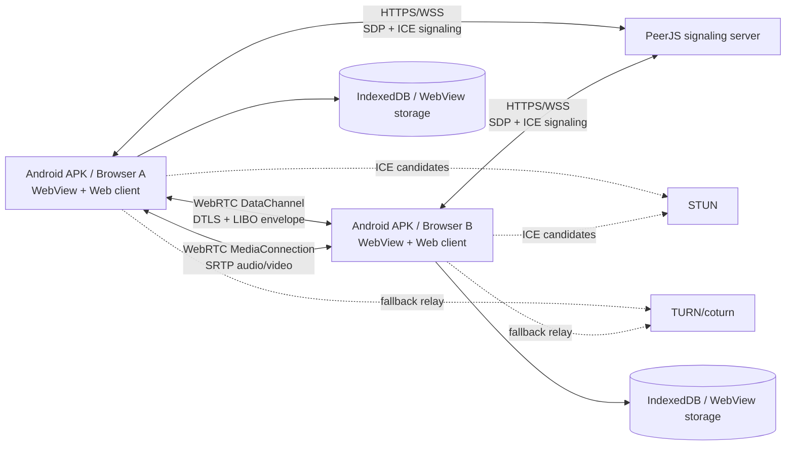

# LIBO Messenger — повна архітектура та сервер

> **Версія документа:** 2.12.0 Standalone  
> **Джерело архітектури:** GitHub `main`, commit `d525b47`  
> **Android package:** `app.libo.messenger.standalone`  
> **Оновлено:** 20 жовтня 2026 року

## 0. Важливе уточнення щодо гілки

Цей документ описує актуальний проєкт LIBO з GitHub `main`. Поточна Arena-гілка
`arena/f3321277-my-first-apk` була створена від старого `vladskod31-alt-patch-1` і в
робочому checkout містить лише legacy HTML-файл та `README.md`. Повна Android/Web
архітектура, яку описано нижче, знаходиться у GitHub `main` і в релізі `v2.12.0`.

Документ не вигадує серверну частину: поточний LIBO є **local-first P2P-месенджером**.
Власного сервера історії, акаунтів, каталогу користувачів або push-доставки в ньому немає.
Серверна частина — це тільки PeerJS signaling, який допомагає двом пристроям знайти одне
одного; самі повідомлення та файли передаються напряму між клієнтами через WebRTC.

---

## 1. Резюме системи

LIBO складається з чотирьох основних частин:

1. **Web-клієнт** — інтерфейс, локальний стан, протокол повідомлень, шифрування,
   IndexedDB, передачі файлів та WebRTC-виклики.
2. **Android WebView shell** — тонка native-оболонка, яка вбудовує зібраний web-бандл,
   підключає системний file picker, native save dialog, дозволи мікрофона/камери,
   deep links `libo://` та локальні нагадування.
3. **PeerJS signaling server** — WebSocket/HTTP-сервіс для обміну службовими SDP/ICE
   даними та пошуку peer ID. Він не зберігає історію повідомлень.
4. **STUN/TURN інфраструктура** — STUN допомагає знайти прямий маршрут, TURN є fallback
   для strict NAT, VPN або корпоративних мереж. TURN ретранслює зашифрований WebRTC
   трафік, але не розшифровує його.

### 1.1. Загальна схема



Після встановлення WebRTC-каналу PeerJS server більше не бере участі в доставці
повідомлення. Якщо обидва клієнти закриті, сервер не має черги повідомлень і не може
доставити їх у фоні.

### 1.2. Що система робить

- особисті чати 1:1 за peer-кодом `LIBO:libo-<32 hex символи>`;
- локальні профілі: ім’я, username, bio, статус, аватар;
- текст, відповіді, редагування, видалення, pin, реакції, read receipts;
- офлайн-черга та повторне підключення;
- вкладення частинами до 100 MiB із підтвердженнями та SHA-256;
- фото, голосові повідомлення, аудіо, музика, відео та документи;
- опитування 1:1 до восьми варіантів;
- QR та `libo://` посилання;
- прямі 1:1 audio/video WebRTC-виклики;
- локальний пошук, чернетки, таймер видалення, нагадування, теми та налаштування.

### 1.3. Чого система не робить

- немає центральних акаунтів, паролів або каталогу користувачів;
- немає серверної історії, cloud sync або server-side backup;
- немає push-доставки при повністю закритому застосунку;
- немає груп, каналів, SFU, live-stream або server-side membership;
- немає глобальної унікальності username;
- немає серверного TTL: тимчасові повідомлення видаляються локальними таймерами;
- немає незалежного аудиту криптографії та немає окремого шифрування локальної IndexedDB.

---

## 2. Репозиторій та модулі

Актуальне дерево `main` має таку логіку:

```text
.
├── web/
│   ├── index.html              # DOM, dialogs, buttons, SVG sprite, accessibility labels
│   ├── app.js                  # UI, application state, event handlers, message lifecycle
│   ├── styles.css              # базові стилі
│   ├── ui-next.css             # дизайн-система LIBO 2.12
│   ├── fonts.css
│   ├── lib/
│   │   ├── core.mjs           # constants, validation, packet builders, IDs, links
│   │   ├── storage.mjs         # IndexedDB Store
│   │   ├── transport.mjs       # PeerJS, DataChannel, calls, dispatch
│   │   ├── attachments.mjs     # chunked files, receipts, resume, SHA-256
│   │   └── mtproto.mjs        # ECDH + AES-GCM application envelope
│   └── public/                 # icons та third-party notices
├── app/
│   └── src/main/
│       ├── AndroidManifest.xml
│       ├── java/app/libo/messenger/
│       │   ├── MainActivity.java
│       │   └── ReminderReceiver.java
│       └── res/                # launcher icons, theme, strings, extraction rules
├── scripts/
│   └── dev-server.mjs          # Vite + локальний PeerJS signaling server
├── tests/
│   ├── *.test.mjs              # unit tests
│   └── *.spec.mjs              # Playwright/WebRTC integration tests
├── downloads/                  # release APK mirror та checksum files
├── dist/                       # production web bundle; створюється npm run build
├── app/build.gradle
├── settings.gradle
├── package.json
└── gradlew
```

### 2.1. Web-клієнт

`web/app.js` — application orchestrator. Він створює `Store`, `Transport` і
`AttachmentTransferManager`, а потім зв’язує їх із UI.

Основний runtime state:

```js
const state = {
  profile: null,          // власний peer ID і публічний профіль
  settings: null,        // тема, signaling URL, TURN, звук, appearance
  chats: [],              // локальні чати та повідомлення
  blocked: [],
  current: null,
  filter: 'all',
  network: 'connecting',
  contactStates: new Map(),
  typing: new Map(),
  drafts: {},
  reply: null,
  attachment: null,
  sending: false,
  transfers: new Map(),
  reminders: [],
  call: null,
};
```

Усі зміни одного чату проходять через серіалізатор `changeChat()`. Це не дозволяє
паралельним `onMessage`, ACK, read receipt та draft-записам перетирати один одного.
Перед зміною об’єкт копіюється, після зміни записується в IndexedDB через `putChat()`.

### 2.2. `core.mjs`

Центральний модуль правил і меж протоколу:

- генерує ID `libo-` + 32 hex символи;
- нормалізує peer-коди, імена, username, bio та MIME;
- перевіряє `libo://user/...`, `chat`, `message`, `file` links;
- будує та перевіряє message/control/file packets;
- визначає ліміти вкладень;
- будує ACK, edit, delete, pin, reaction, read та poll packets;
- рахує verification code двох peer ID;
- формує текстовий export без приватних peer ID та signaling secrets.

Найважливіші константи:

| Константа | Значення |
|---|---:|
| `MAX_TEXT` | 4000 символів |
| `MAX_MESSAGES` | 500 повідомлень на чат |
| `MAX_CHATS` | 100 чатів на пристрій |
| `FILE_CHUNK_SIZE` | 24 KiB |
| фото | 12 MiB |
| voice | 5 MiB та максимум 60 секунд |
| audio/music | 100 MiB |
| video | 100 MiB |
| document | 100 MiB |
| polls | максимум 8 варіантів |
| pins | максимум 10 на чат |

`validatePacket()` застосовується до кожного вхідного packet до передачі його в
application state. Неправильний packet або packet із перевищеним лімітом закриває
з’єднання або відкидається; untrusted object не spread-иться напряму в state.

### 2.3. `storage.mjs`

IndexedDB database:

```text
name:    libo-messenger-v2
version: 3
stores:  meta, chats, attachments, attachmentChunks
```

Сховища:

| Object store | Key | Вміст |
|---|---|---|
| `meta` | string | `profile`, `settings`, `blocked`, `drafts`, `reminders`, `lastSeen` |
| `chats` | `chat.id` | локальний чат, message metadata, unread, folder, pins |
| `attachments` | `attachment.id` | metadata, Blob, стан transfer, SHA-256 |
| `attachmentChunks` | `[fileId, index]` | прийняті частини Blob; index `byFile` |

Attachment bytes не лежать усередині chat object. Це запобігає серіалізації 100 MiB
файла під час кожної зміни чату.

При відкритті програма:

1. відкриває IndexedDB;
2. завантажує або створює profile;
3. відновлює settings, blocked, chats, drafts, reminders;
4. створює спеціальний локальний чат `saved` / «Избранное»;
5. запускає таймери TTL і reminders;
6. запускає `Transport.start()`.

### 2.4. `transport.mjs`

`Transport` відповідає за:

- створення PeerJS `Peer(profile.id, options)`;
- відкриття reliable binary DataConnection з label `libo-v2`;
- simultaneous dialing arbitration;
- hello/profile/capabilities handshake;
- packet validation та dispatch;
- reconnect із backoff до 30 секунд;
- ECDH application session;
- PeerJS MediaConnection для audio/video;
- WebRTC diagnostics: ICE state, RTT, jitter, packet loss;
- close/reject/block handling.

Якщо два клієнти одночасно dial-ять один одного, залишається одне з’єднання. Правило:
peer з меншим ID визначає напрямок, щоб duplicate connections не залишалися активними.

---

## 3. Життєвий цикл підключення

### 3.1. Створення особистого коду

Під час першого запуску:

```js
const id = `libo-${crypto.randomUUID().replaceAll('-', '')}`;
const code = `LIBO:${id}`;
```

ID зберігається локально в IndexedDB у `meta.profile`. Особистий код — це не пароль і не
серверний акаунт. Він є адресою peer у signaling-системі.

### 3.2. Додавання контакту

1. Користувач відкриває «Почати спілкування».
2. Вставляє `LIBO:libo-...`.
3. `normalizePeerCode()` перевіряє формат.
4. Власний код, заблокований код або некоректний код відхиляється.
5. Створюється локальний chat object.
6. `Transport.connect(id)` намагається знайти peer через signaling server.
7. Обидва клієнти мають бути відкритими одночасно.

### 3.3. Hello handshake

Після відкриття DataConnection клієнт надсилає:

```json
{
  "v": 1,
  "type": "hello",
  "id": "libo-aaaaaaaaaaaaaaaaaaaaaaaaaaaaaaaa",
  "name": "Користувач LIBO",
  "caps": ["chunk-files-v1", "profiles-v1", "mentions-v1", "links-v1", "calls-v1"],
  "profile": {
    "username": "",
    "bio": "",
    "status": "online",
    "avatar": ""
  }
}
```

Отримувач перевіряє `id`, ім’я, capabilities та profile, зберігає контакт локально і
лише після завершення IndexedDB commit переводить контакт у `online`.

### 3.4. Встановлення application security session

Після hello кожна сторона генерує ephemeral ECDH P-256 key pair та обмінюється
`mt-hello`. З двох public keys утворюється однакова `authKey`. Старі клієнти, які не
розуміють `mt-hello`, залишаються на захисті DTLS DataChannel.

### 3.5. Відправка тексту

1. `sendMessage()` створює UUID message.
2. Повідомлення одразу записується локально зі статусом `queued`.
3. Якщо channel відкритий, `flushPending()` формує packet і викликає `transport.send()`.
4. Після передачі DataChannel статус стає `sent`.
5. Отримувач перевіряє packet, записує його в IndexedDB та надсилає `ack`.
6. Відправник отримує ACK та ставить `delivered`.
7. Коли чат відкритий на отримувачі, надсилається `read`; відправник показує `read`.

Статуси мають реальний зміст:

| Статус | Значення |
|---|---|
| `local` | тільки локальне «Избранное» |
| `queued` | збережено локально, P2P канал не відкритий |
| `sent` | envelope передано в DataChannel |
| `delivered` | metadata збережена на пристрої отримувача |
| `read` | отримано read receipt |
| `failed` | локальна або протокольна помилка |

`delivered` не означає, що сервер зберіг повідомлення: сервер повідомлень у LIBO немає.

### 3.6. Offline/reconnect

Повідомлення зберігається локально, якщо контакт offline. `retryConnections()` повторює
спробу для чатів із queued/sent/uploading повідомленнями. PeerJS reconnect має backoff:
2, 4, 8, 16, 30 секунд. Після reconnect `flushPending()` відправляє до 25 pending
повідомлень за один цикл, дедуплікація на отримувачі відбувається за message ID.

---

## 4. Протокол повідомлень

Усі application packets мають `v: 1` та проходять `validatePacket()`.
Коли application security session готова, payload завертається в envelope `type: mt`.

### 4.1. Control та message packet types

| Type | Напрямок | Призначення |
|---|---|---|
| `hello` | обидва | peer ID, ім’я, capabilities, public profile |
| `mt-hello` | обидва | ephemeral ECDH public key |
| `mt` | обидва | AES-GCM encrypted application packet |
| `message` | sender → receiver | текст, reply, mentions, TTL та attachment metadata |
| `ack` | receiver → sender | metadata прийнята та збережена |
| `typing` | обидва | typing indicator |
| `edit` | обидва | зміна тексту повідомлення |
| `delete` | обидва | delete-for-both для до 20 message IDs |
| `pin` | обидва | add/remove pin |
| `react` | обидва | шість дозволених реакцій |
| `read` | receiver → sender | read up to timestamp |
| `pollvote` | обидва | голос за option |
| `file-resume` | receiver → sender | запит відновлення transfer |
| `file-state` | receiver → sender | наступний contiguous chunk |
| `file-chunk` | sender → receiver | base64-encoded chunk |
| `file-receipt` | receiver → sender | chunk записано в IndexedDB |
| `file-complete` | sender → receiver | всі chunks надіслані |
| `file-missing` | receiver → sender | потрібен chunk з index |
| `file-ack` | receiver → sender | файл зібраний і SHA-256 перевірений |
| `file-cancel` | обидва | скасування transfer |

### 4.2. Приклад звичайного message packet

```json
{
  "v": 1,
  "type": "message",
  "id": "4a7b1b50-1d83-4f76-8bda-27dc78c1ad32",
  "text": "Привіт",
  "at": 1760976000000,
  "reply": null,
  "mentions": [],
  "ttl": 0,
  "timing": {
    "clientCreatedAt": 1760976000000,
    "sendStartedAt": 1760976000100
  }
}
```

### 4.3. Приклад attachment metadata

```json
{
  "kind": "file",
  "fileId": "8b1c3d76-95c0-4e5a-92e0-48b4ed7c6c1e",
  "name": "document.pdf",
  "mime": "application/pdf",
  "size": 1048576,
  "chunkSize": 24576,
  "totalChunks": 43,
  "sha256": "0123456789abcdef0123456789abcdef0123456789abcdef0123456789abcdef"
}
```

У першому `message` передається лише metadata. Blob не вкладається одним великим
Base64-повідомленням.

### 4.4. Rate limits на DataConnection

`Transport.receive()` застосовує локальний anti-flood guard на кожне connection:

- у вікні 10 секунд — максимум 1000 file chunks;
- у тому ж вікні — максимум 160 control/message packets;
- перевищення закриває connection;
- максимум 24 одночасні connection/attempts у transport;
- hello timeout — 15 секунд.

Ці обмеження не замінюють production anti-abuse систему: централізованого anti-spam у
поточній P2P редакції немає.

---

## 5. Передача файлів

### 5.1. Outgoing flow

```text
1. File picker / recorder
2. Validate MIME та size
3. Persist Blob у IndexedDB
4. Порахувати SHA-256
5. Створити metadata з fileId/chunkSize/totalChunks
6. Відправити message metadata
7. Receiver створює incoming attachment record
8. Receiver → file-resume
9. Sender → file-chunk[index]
10. Receiver записує chunk у IndexedDB
11. Receiver → file-receipt[index]
12. Після останньої частини sender → file-complete
13. Receiver збирає contiguous chunks
14. Receiver перевіряє розмір і SHA-256
15. Receiver → file-ack(ok=true)
16. Sender ставить delivered
```

### 5.2. Reconnect/resume

Отримувач зберігає `nextChunk` — кількість послідовних частин від нуля. Після повторного
підключення sender надсилає `file-resume`; receiver повертає `file-state`. Уже прийняті
частини не перезаписуються, а sender продовжує з першого missing index.

Кожен chunk підтверджується лише після commit в IndexedDB. Якщо фінальна SHA-256 не
збігається, отримувач видаляє chunks, ставить `failed` і відправляє негативний `file-ack`.

### 5.3. Ліміти

| Тип | Ліміт | Особливості |
|---|---:|---|
| JPG/PNG/WebP | 12 MiB | фото з кнопки стискається до JPEG максимум 1600 px |
| voice | 5 MiB / 60 секунд | формат визначає `MediaRecorder` |
| audio/music | 100 MiB | оригінальний Blob без перекодування |
| video | 100 MiB | MP4/WebM/MOV/MKV, codec залежить від WebView |
| document | 100 MiB | оригінальний формат |
| chunk | 24 KiB | Base64 лише для окремої частини |

---

## 6. Audio/video calls

Виклики не є fake UI та не є message packets.

1. Контакт повинен бути online і мати capability `calls-v1`.
2. Користувачський gesture запускає `getUserMedia()`.
3. `Transport.startCall()` викликає `peer.call()` з metadata:

```json
{
  "protocol": "libo-call-v1",
  "kind": "audio"
}
```

4. Отримувач отримує реальний PeerJS `MediaConnection`.
5. Він бачить `ringing`, явно приймає виклик і передає власний MediaStream.
6. `connected` показується лише після фактичного remote stream.
7. `RTCPeerConnection` state та ICE state дають `reconnecting`/`failed`/`ended`.
8. Доступні mute, camera on/off, завершення та diagnostics.

Потрібні одночасно відкриті клієнти. Немає background incoming call, recording, SFU,
server relay guarantee або автоматичного redial після terminal failure.

---

## 7. Криптографія та модель довіри

### 7.1. Транспортний рівень

WebRTC DataChannel використовує DTLS, а MediaConnection — SRTP. PeerJS signaling
передає лише службові адреси/SDP/ICE для побудови каналу.

### 7.2. Додатковий application envelope

`mtproto.mjs` — це не Telegram MTProto і не server-client MTProto. Це локальний
MTProto-inspired envelope для serverless P2P:

1. кожна сторона генерує ECDH P-256 ephemeral pair;
2. public key передається в `mt-hello`;
3. shared secret отримується через ECDH;
4. `authKey = SHA-256(sharedSecret || "libo-mt-v1")`;
5. для plaintext обчислюється `msgKey`;
6. KDF виводить AES-256 key та 96-bit IV;
7. payload шифрується AES-256-GCM;
8. `msg_id` монотонний та time-based;
9. `msg_key` і `msg_id` входять у AES-GCM additional authenticated data;
10. receiver відкидає replay, stale/future message, tampered ciphertext або неправильний
    `msg_key`.

Спрощена форма envelope:

```json
{
  "v": 1,
  "type": "mt",
  "msg_id": 7386022211092481,
  "mk": "base64-16-byte-msg-key",
  "iv": "base64-12-byte-iv",
  "ct": "base64-aes-gcm-ciphertext"
}
```

У verification dialog показується короткий fingerprint пари. Його слід звірити через
довірений канал; це не централізована identity verification.

### 7.3. Реальні обмеження безпеки

- peer code — адреса, а не пароль і не доказ особи;
- signaling operator бачить metadata з’єднань, час та peer IDs;
- сервер історії не бачить ciphertext повідомлень, але signaling metadata доступна його
  оператору;
- локальна IndexedDB/WebView storage не шифрується окремим database key;
- немає незалежного криптоаудиту;
- при поганій конфігурації signaling/TURN доступність може бути відсутньою;
- export навмисно не включає приватні peer IDs, attachment bytes та signaling secrets.

У документації та UI не слід називати цю систему незалежно перевіреним «абсолютним E2EE».
Коректне твердження: WebRTC DTLS плюс application-level ECDH/AES-GCM envelope між двома
клієнтами, з локальною історією.

---

## 8. Android shell

### 8.1. Завантаження web assets

`MainActivity` відкриває тільки локальний origin:

```text
https://appassets.androidplatform.net/index.html
```

Production web bundle лежить у `dist/` і пакується в APK через:

```gradle
sourceSets { main { assets.srcDirs = ["${rootDir}/dist"] } }
```

`LocalContentClient` обмежує завантаження локальними assets та дозволеними ресурсами.
WebView налаштований так, щоб:

- JavaScript і DOM storage були дозволені для bundled app;
- file access з file URL був вимкнений;
- universal file URL access був вимкнений;
- mixed content був заборонений;
- multiple windows та автоматичне відкриття вікон були вимкнені;
- Safe Browsing був увімкнений;
- CSP дозволяв self, HTTPS/WSS signaling, blob media та локальні assets.

### 8.2. Native bridge `LiboAndroid`

Bridge доступний тільки локальному WebView application origin і використовується для:

- ACTION_OPEN_DOCUMENT file picker;
- ACTION_CREATE_DOCUMENT для export/збереження attachment;
- bounded Base64 bridge chunks із backpressure;
- `RECORD_AUDIO` / `CAMERA` runtime permission після user action;
- зміни Android system bar theme;
- `libo://user|chat|message|file` deep links;
- `AlarmManager` reminders;
- POST_NOTIFICATIONS на Android 13+ лише під час створення reminder.

Неавторизований WebView origin або невідома media permission resource відхиляються.

### 8.3. Manifest permissions

```xml
<uses-permission android:name="android.permission.INTERNET" />
<uses-permission android:name="android.permission.RECORD_AUDIO" />
<uses-permission android:name="android.permission.CAMERA" />
<uses-permission android:name="android.permission.POST_NOTIFICATIONS" />
```

У manifest `usesCleartextTraffic="false"`, launch activity exported, а `libo:` intent
filter дозволяє відкривати перевірені deep links.

---

## 9. Серверна архітектура

### 9.1. Що є «сервером» у поточній системі

У поточній редакції є лише signaling server:

```text
Client A ── HTTPS/WSS ──> PeerJS Server <── HTTPS/WSS ── Client B
                              │
                              └─ SDP/ICE/peer discovery only

Client A ═══════════════ WebRTC DataChannel ═══════════════ Client B
```

PeerJS server:

- реєструє активний peer ID;
- допомагає встановити signaling WebSocket;
- передає SDP/ICE negotiation messages;
- не отримує application message history;
- не зберігає chat database;
- не доставляє queued message, якщо обидва клієнти offline;
- не робить authentication/account management;
- не є TURN relay.

### 9.2. Вбудований development server — повний код

Це фактичний файл `scripts/dev-server.mjs` з GitHub `main`. Він об’єднує Vite
middleware і локальний ExpressPeerServer на одному порту. Для Vite HMR створюється
окремий non-listening HTTP emitter, щоб PeerJS upgrade не конфліктував із HMR.

```js
import express from 'express';
import http from 'node:http';
import { createServer as createViteServer } from 'vite';
import { ExpressPeerServer } from 'peer';

const app = express();
const httpServer = http.createServer(app);

// PeerJS має окремий HTTP emitter, але слухає той самий зовнішній порт через upgrade.
// Це не дає PeerJS повертати HTTP 400 на Vite HMR upgrade.
const signalingTransport = http.createServer();

app.use('/peerjs', ExpressPeerServer(signalingTransport, {
  path: '/',
  proxied: true,
  allow_discovery: false,
  concurrent_limit: 100,
}));

httpServer.on('upgrade', (request, socket, head) => {
  if (request.url?.startsWith('/peerjs/')) {
    signalingTransport.emit('upgrade', request, socket, head);
  }
});

const vite = await createViteServer({
  server: {
    middlewareMode: true,
    hmr: { server: httpServer, path: '/__vite_hmr' },
  },
});

app.use(vite.middlewares);

const port = Number(process.env.PORT || 5173);
httpServer.listen(port, '0.0.0.0', () => {
  console.log('LIBO preview ready on 0.0.0.0:' + port);
});

for (const signal of ['SIGINT', 'SIGTERM']) {
  process.on(signal, async () => {
    await vite.close();
    httpServer.close(() => process.exit(0));
  });
}
```

Запуск:

```sh
npm ci
npm run dev
# Vite + local PeerJS: http://127.0.0.1:5173
# signaling path: http://127.0.0.1:5173/peerjs/
```

Локальний HTTP signaling дозволений лише коли `signalUrl` збігається з local origin;
для production клієнт приймає тільки HTTPS signaling.

### 9.3. Production signaling server: systemd + Caddy

Production signaling повинен мати TLS. Приклад для Debian/Ubuntu:

```sh
sudo apt update
sudo apt install -y nodejs npm caddy
sudo npm install --global peer
sudo useradd --system --home /srv/peerjs --shell /usr/sbin/nologin peerjs
sudo mkdir -p /srv/peerjs
sudo chown -R peerjs:peerjs /srv/peerjs
```

`/etc/systemd/system/libo-peerjs.service`:

```ini
[Unit]
Description=LIBO PeerJS signaling server
After=network.target

[Service]
Type=simple
User=peerjs
WorkingDirectory=/srv/peerjs
ExecStart=/usr/local/bin/peerjs --port 9000 --path /peerjs --key peerjs --allow_discovery false
Restart=always
RestartSec=3
NoNewPrivileges=true
PrivateTmp=true
ProtectSystem=strict
ProtectHome=true
ReadWritePaths=/srv/peerjs

[Install]
WantedBy=multi-user.target
```

Запуск:

```sh
sudo systemctl daemon-reload
sudo systemctl enable --now libo-peerjs
sudo systemctl status libo-peerjs
```

`/etc/caddy/Caddyfile`:

```text
signal.example.org {
    encode gzip
    reverse_proxy /peerjs/* 127.0.0.1:9000
}
```

```sh
sudo systemctl reload caddy
curl -fsS https://signal.example.org/peerjs
```

В обох застосунках у налаштуваннях потрібно вказати:

```text
https://signal.example.org/peerjs/
```

Обов’язкові правила:

- тільки HTTPS у production;
- path клієнта має збігатися з PeerJS `--path`;
- trailing slash бажаний: `/peerjs/`;
- не передавати username/password/query/hash у signaling URL;
- проксі має підтримувати WebSocket upgrade;
- PeerJS discovery вимкнений;
- сервер не повинен логувати або зберігати application payload.

### 9.4. Production signaling server: Docker Compose

Це приклад розгортання. У production потрібно зафіксувати конкретну версію або image
digest замість безконтрольного `latest`.

`docker-compose.yml`:

```yaml
services:
  peerjs:
    image: peerjs/peerjs-server:latest
    command:
      - -port
      - "9000"
      - -path
      - /peerjs
      - -key
      - peerjs
      - --allow_discovery
      - "false"
    expose:
      - "9000"
    restart: unless-stopped
    read_only: true
    security_opt:
      - no-new-privileges:true

  caddy:
    image: caddy:2
    ports:
      - "80:80"
      - "443:443"
    volumes:
      - ./Caddyfile:/etc/caddy/Caddyfile:ro
      - caddy_data:/data
      - caddy_config:/config
    depends_on:
      - peerjs
    restart: unless-stopped

volumes:
  caddy_data:
  caddy_config:
```

`Caddyfile` для Compose:

```text
signal.example.org {
    reverse_proxy /peerjs/* peerjs:9000
}
```

Запуск:

```sh
docker compose up -d
curl -fsS https://signal.example.org/peerjs
```

### 9.5. TURN server — coturn

TURN потрібен, коли прямий ICE route не працює через strict NAT. Він не замінює
signaling server.

Мінімальний `/etc/turnserver.conf`:

```text
listening-port=3478
tls-listening-port=5349
listening-ip=0.0.0.0
relay-ip=<internal-ip>
external-ip=<public-ip>/<internal-ip>
min-port=49152
max-port=49252
realm=turn.example.org
cert=/etc/letsencrypt/live/turn.example.org/fullchain.pem
pkey=/etc/letsencrypt/live/turn.example.org/privkey.pem
no-cli
no-tcp-relay
use-auth-secret
static-auth-secret=<openssl-rand-hex-32>

# Не дозволяти реле у приватні мережі.
denied-peer-ip=10.0.0.0-10.255.255.255
denied-peer-ip=172.16.0.0-172.31.255.255
denied-peer-ip=192.168.0.0-192.168.255.255
```

```sh
sudo apt install -y coturn
sudo systemctl enable --now coturn
```

Відкрити firewall:

```text
3478/tcp
3478/udp
5349/tcp
49152-49252/udp
```

LIBO передає TURN у `RTCPeerConnection` через settings:

```text
TURN URL:  turns:turn.example.org:5349?transport=tcp
TURN user: <temporary-username>
TURN pass: <temporary-password>
```

Клієнт перевіряє URL, вимагає всі три поля та додає TURN до ICE server list. За
замовчуванням використовуються:

```text
stun:stun.l.google.com:19302
stun:stun.cloudflare.com:3478
```

Для privacy та доступності production краще використовувати власний TURN, але TURN
не повинен зберігати або розшифровувати application traffic.

### 9.6. Server health та операції

PeerJS signaling — stateful у межах активних WebSocket connections. Для одного інстансу
достатньо systemd/Docker restart policy. Для кількох інстансів потрібні sticky sessions
та перевірена shared signaling topology; поточний клієнт не містить Redis adapter або
server-side peer registry.

Моніторити потрібно:

- процес PeerJS та memory/CPU;
- кількість активних WebSocket connections;
- TCP 443 та WebSocket upgrade;
- latency до STUN/TURN;
- TURN relay allocation, bandwidth та port range;
- TLS expiry;
- частоту reconnect/error у клієнтському UI.

Не логувати:

- текст повідомлень;
- attachment content;
- ECDH private keys;
- TURN passwords;
- експортовані профілі.

---

## 10. Build та deployment

### 10.1. Web production bundle

```sh
npm ci
npm run build
```

Результат — `dist/`, який пакується в APK і може бути розданий статичним hosting-ом.
Для production static preview:

```sh
npm run preview -- --host 0.0.0.0
```

`vite preview` сам по собі не є PeerJS signaling server. Для локальної розробки
використовуйте `npm run dev`, який піднімає і Vite, і local PeerJS.

### 10.2. Android Gradle build

```sh
npm ci
npm run build
./gradlew --no-daemon assembleDebug
```

Gradle config:

```text
compileSdk: 35
targetSdk: 35
minSdk: 26
versionName: 2.12.0
versionCode: 2120000
```

Release APK має бути підписаний приватним ключем, який не зберігається в репозиторії.
Зміна signing key створює окрему Android installation lineage і не дає оновити старий APK
поверх попереднього.

### 10.3. Fallback build без Gradle

У репозиторії є pinned fallback toolchain для Linux x64:

```sh
node scripts/bootstrap-toolchain.mjs
export JAVA_HOME="$HOME/.local/share/libo-toolchain/runtime/jre"
export LIBO_TOOLCHAIN="$HOME/.local/share/libo-toolchain/android"
./scripts/build-apk-local.sh
```

Він використовує AAPT2, ECJ, D8, zipalign та apksigner; toolchain завантажується поза
репозиторієм і перевіряється SHA-256.

---

## 11. Testing та перевірка

### Unit

```sh
npm test
```

Перевіряються:

- ID та peer-code validation;
- packet limits та untrusted packet rejection;
- profiles, mentions, deep links;
- ECDH/AES-GCM envelope, replay та tamper rejection;
- attachment MIME, limits, chunk encoding та SHA-256;
- transfer resume/ACK;
- call state transitions.

### Browser integration

```sh
npm run test:e2e
```

Playwright створює два незалежні клієнти й локальний PeerJS server. Сценарії перевіряють:

- welcome/profile/invite code/QR;
- text, ACK, read receipt, reply, edit, delete, reaction, pin;
- офлайн-чергу та reconnect;
- attachment і відновлення transfer після reconnect;
- polls, TTL, search, drafts, themes, gestures;
- реальний локальний WebRTC audio call із fake capture devices;
- mobile viewport та відсутність horizontal overflow.

Це не замінює перевірку на фізичному Android: Android WebView, permissions, камера,
мікрофон, backgrounding, mobile NAT та реальний codec matrix потребують device test.

### Ручний smoke test

1. Відкрити два клієнти.
2. Перевірити, що кожен бачить «Вы в сети».
3. Скопіювати код першого клієнта.
4. Додати його в другому через «Почати спілкування».
5. Переконатися, що обидва чати відкриті.
6. Надіслати `Привіт`.
7. Перевірити `sent → delivered → read`.
8. Відключити один клієнт, надіслати ще одне повідомлення, підключити назад.
9. Перевірити offline queue.
10. Відкрити меню безпеки та звірити verification code на обох сторонах.
11. Перевірити файл, reconnect та SHA-256 delivery.
12. Перевірити permissions для audio/video call.

---

## 12. Безпечна конфігурація production

### Мінімальна схема firewall

```text
443/tcp       Caddy/TLS + PeerJS WebSocket proxy
80/tcp        тільки ACME redirect/challenge
3478/tcp+udp  TURN
5349/tcp      TURN over TLS
49152-49252/udp TURN relay range
9000/tcp      тільки localhost/private Docker network
```

### Secrets

Ніколи не комітити:

- release keystore та passwords;
- TURN static secret або generated credentials;
- private keys;
- `.env` з production host credentials;
- user exports та local IndexedDB dumps.

### TLS

- використовувати валідний сертифікат домену;
- redirect HTTP → HTTPS;
- не дозволяти клієнтський `http://` signaling поза localhost;
- перевіряти WebSocket upgrade через reverse proxy;
- ротувати TURN credentials;
- контролювати certificate expiry.

---

## 13. Межі масштабування та майбутня server edition

Поточна P2P архітектура добре підходить для приватних 1:1 чатів, але не для server-side
product features. Для повноцінної cloud/server edition доведеться додати окремі сервіси:

```text
API gateway
├── identity/auth service
├── contacts/profile directory
├── message relay + durable queue
├── encrypted message store
├── push notification service
├── group/channel membership service
├── media/blob storage
├── TURN fleet
├── rate limit / abuse service
└── observability/audit pipeline
```

Це **не реалізовано** у v2.12.0 і не повинно описуватися як наявна функціональність.
Для такої редакції треба окремо спроєктувати:

- authentication і device/session keys;
- multi-device conflict resolution;
- durable encrypted queue;
- server-side retention policy;
- group key management;
- push tokens;
- upload authorization та object storage;
- rate limiting, abuse reporting та moderation;
- horizontal PeerJS/signaling topology;
- formal threat model і незалежний security audit.

---

## 14. Короткий runbook

### Локальна розробка

```sh
npm ci
npm run dev
```

Відкрити `http://127.0.0.1:5173`. Внутрішній signaling URL у dev:

```text
http://127.0.0.1:5173/peerjs/
```

### Production web + окремий signaling

```sh
npm ci
npm test
npm run test:e2e
npm run build
npm run preview -- --host 0.0.0.0
```

На клієнтах встановити власний URL:

```text
https://signal.example.org/peerjs/
```

### Власний signaling server

```sh
sudo systemctl enable --now libo-peerjs
sudo systemctl reload caddy
curl -fsS https://signal.example.org/peerjs
```

### APK

```sh
npm run build
./gradlew --no-daemon assembleRelease
```

Перед встановленням перевірити package, version, signature та SHA-256.

---

## 15. Підсумок

LIBO 2.12.0 — це не типовий централізований месенджер. Його canonical architecture:

```text
local WebView/browser state
        │
        ├── IndexedDB: chats, drafts, profiles, attachments
        ├── PeerJS: only signaling/discovery
        ├── WebRTC DataChannel: messages and file chunks
        ├── WebRTC MediaConnection: audio/video
        ├── DTLS/SRTP: transport encryption
        └── ECDH P-256 + AES-256-GCM: optional application envelope
```

**Повний актуальний сервер** у цій архітектурі — це signaling PeerJS плюс, за потреби,
власний TURN. Немає прихованого message backend, який зберігає або доставляє історію.
Саме тому обидва клієнти мають бути відкритими для першого з’єднання та доставки
повідомлення.
