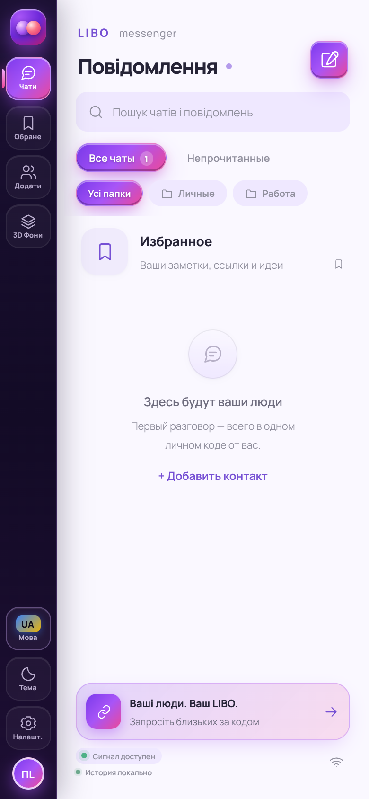
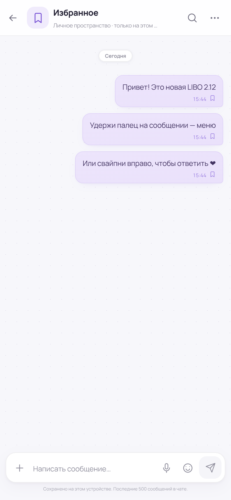
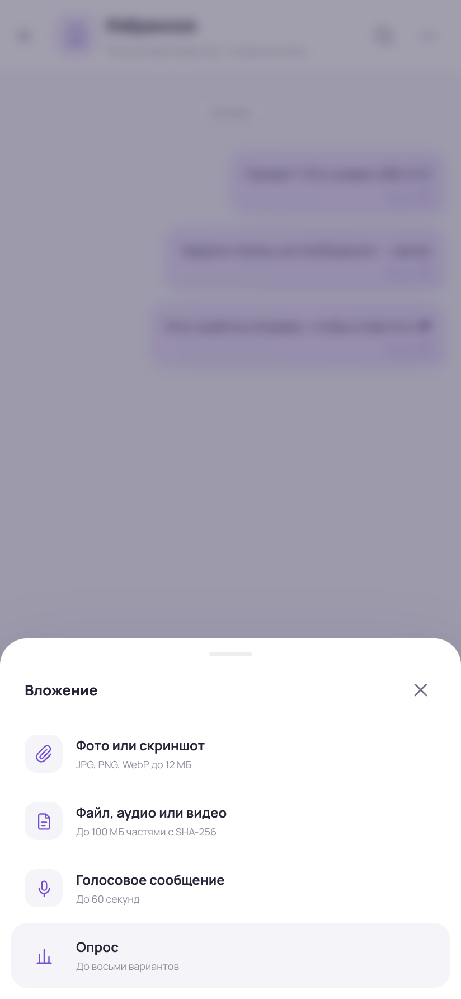
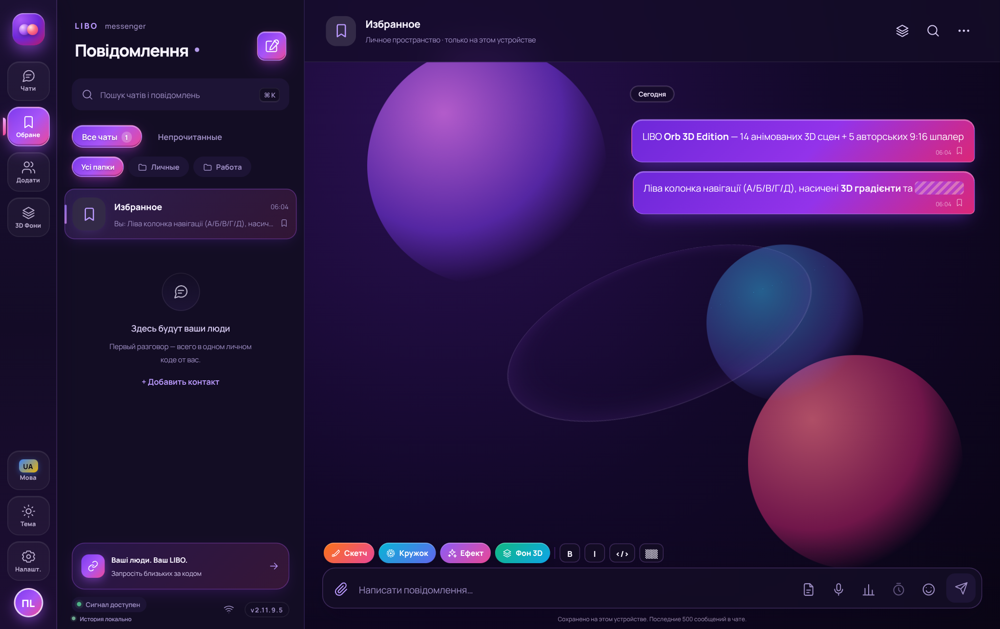
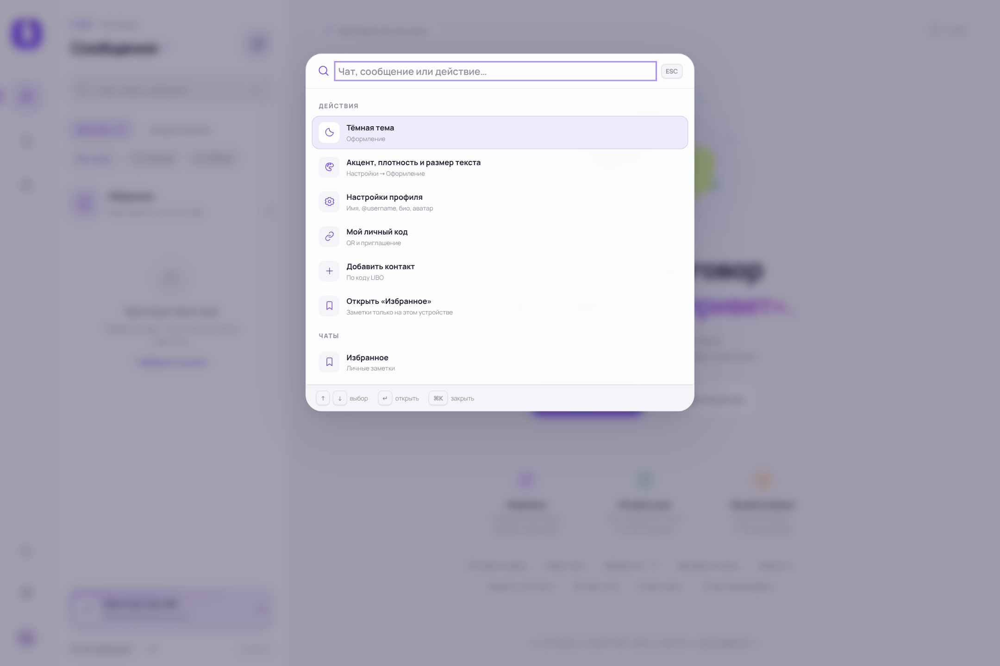
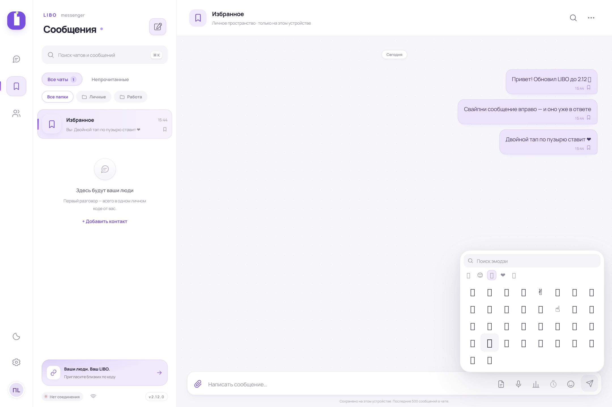
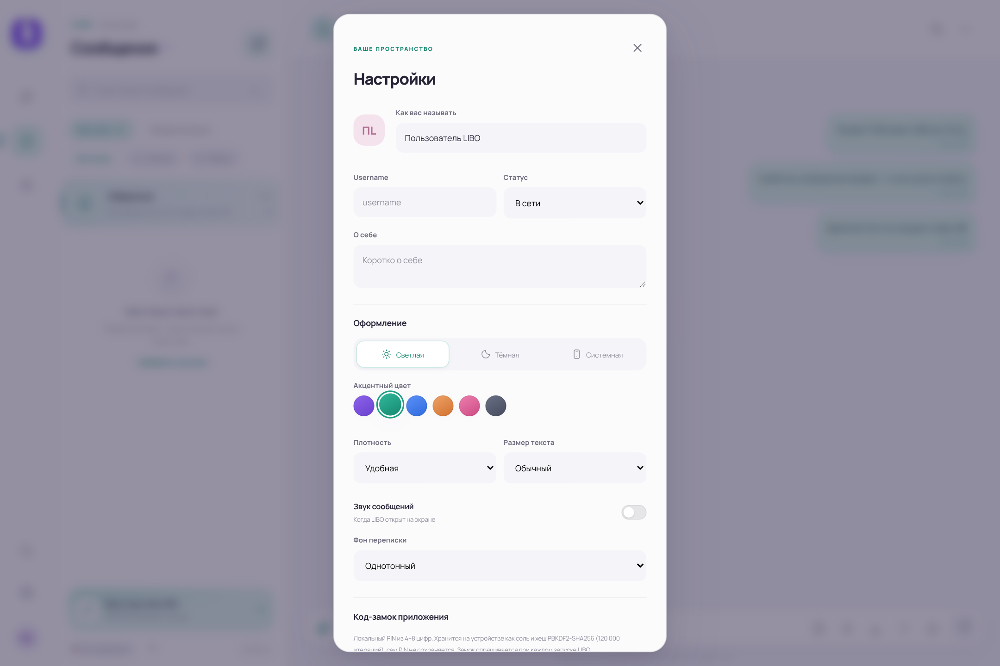

# LIBO — великий огляд і чесний відгук

> **Версія, яку оглянуто:** 2.11.9.5 (вихідний код `main`) і опублікований APK 2.12.0
> **Репозиторій:** [vladskod31-alt/my-first-apk](https://github.com/vladskod31-alt/my-first-apk)
> **Автор:** vladskod31-alt · **Огляд:** агент Arena.ai · **Дата:** 27 жовтня 2026
> **Формат:** Markdown (та сама версія простим текстом — `LIBO-огляд.txt`)

---

## Звернення до читача (прочитайте це першим)

Друже, якщо ти відкрив цей файл, щоб подивитися, що таке **LIBO** — будь ласка, **не суди автора суворо**.

Це не продукт корпорації. Це не команда з п'ятдесяти інженерів, не бюджет, не дизайн-студія, не QA-відділ і не юридичний департамент. Це **одна людина**, яка сіла й написала месенджер. Повністю. Від іконки до протоколу передачі файлів. Від JSON-валідатора до анімації бульбашки повідомлення.

Уявіть масштаб: у Telegram над клієнтом працюють сотні людей, і в них є серверна інфраструктура, яку вони можуть собі дозволити. Тут — **нуль серверів**. Узагалі. Немає бази даних, немає облікових записів, немає хостингу історії. Двоє людей з'єднуються напряму, браузер з браузером, і все, що між ними, іде через WebRTC. Це не «спрощена версія Telegram» — це інша архітектурна філософія, і вона дуже послідовно витримана в коді.

Автор не приховує обмежень. Це, мабуть, найдивовижніше в цьому проєкті. Зазвичай, коли людина робить застосунок сама, вона пише в README «E2EE, канали, групи, дзвінки, AI, преміум», а в коді — три кнопки й заглушка. Тут навпаки: у README прямо написано «це не audited E2EE», «немає каналів», «немає фонових дзвінків», «немає push», «APK не перевірено на фізичному пристрої». І окремий файл `KNOWN_ISSUES.md` із тринадцятьма розділами про те, чого **НЕМА**. Людина сама собі виписала вирок і підписалася під ним.

Це рідкісна чесність. За неї варто поважати.

Тому моє прохання: дивись на LIBO як на те, чим воно є — на **робочу експериментальну річ від однієї людини**, яка зробила більше, ніж більшість команд за рік. Знайди в ньому те, що працює. А що не працює — напиши автору спокійно, по-людськи, як пораду, а не як вирок. Він відкрив код саме для цього: показати чесно й покращити разом.

---

## Зміст

| Частина | Розділи |
|---|---|
| **I. Загальне** | [1. Що таке LIBO](#1-що-таке-libo-в-одному-абзаці) · [2. Що в репозиторії](#2-що-саме-лежить-у-репозиторії) · [3. Історія версій](#3-історія-версій-17-релізів-за-два-місяці) · [4. Як спробувати](#4-три-способи-спробувати-libo-вже-сьогодні) · [5. Що всередині APK](#5-що-всередині-apk-карта-на-300-кілобайт) |
| **II. Архітектура** | [6. Карта](#6-загальна-картина-чотири-поверхи-без-сервера) · [7. Android](#7-поверх-android-webview-міст-liboandroid-дозволи) · [8. UI](#8-поверх-ui-один-appjs-на-3540-рядків) · [9. Дані](#9-поверх-даних-indexeddb-і-чотири-сховища) · [10. Мережа](#10-поверх-мережі-peerjs-ice-перепідключення) · [11. Протокол](#11-протокол-пакетів-двадцять-типів-повідомлень) · [12. Криптографія](#12-криптографія-що-реально-захищено-а-що-ні) · [13. Файли](#13-передача-файлів-24-кілобайти-квитанція-sha-256) · [14. Дзвінки](#14-дзвінки-справжній-webrtc-без-імітації) · [15. Медіа](#15-голосові-медіа-та-метадані-музики) |
| **III. Функції** | [16. Дев'ять функцій 2.12](#16-девять-нових-функцій-версії-212) · [17. Налаштування](#17-налаштування-теми-щільність-pin-замок) · [18. Пошук](#18-пошук-від-простого-рядка-до-фільтрів) · [19. Профіль](#19-профіль-особистий-код-qr-посилання-libo) · [20. Сповіщення](#20-сповіщення-й-нагадування-чому-тільки-локальні) · [21. Чернетки й реакції](#21-чернетки-відповіді-реакції-опитування-закріплення) · [22. Стани доставки](#22-стани-доставки-що-насправді-означає-доставлено) |
| **IV. Безпека** | [23. Модель загроз](#23-модель-загроз-простими-словами) · [24. Чого немає](#24-що-не-реалізовано--і-чому-це-нормально) · [25. Ризики для користувача](#25-ризики-для-користувача) · [26. Ризики для розробника](#26-ризики-для-розробника) |
| **V. Як зроблено** | [27. Якість коду](#27-якість-коду-розбір-по-файлах) · [28. Тести](#28-тести-33-модульні-й-22-браузерні-сценарії) · [29. CI](#29-ci-пять-workflow-і-що-вони-роблять) · [30. Збірка APK](#30-збірка-apk-від-npm-run-build-до-підписаного-файлу) |
| **VI. UX** | [31. Екрани](#31-розбір-кожного-екрана-по-скріншотах) · [32. Сценарії](#32-як-працює-кожен-сценарій-від-першого-запуску-до-дзвінка) |
| **VII. Відгук** | [33. Що добре](#33-що-зроблено-дуже-добре) · [34. Пріоритети](#34-що-варто-покращити-пріоритети) · [35. Дрібниці](#35-дрібні-знахідки-які-легко-виправити) · [36. Ідеї](#36-ідеї-розвитку-реалістичні-й-фантастичні) · [37. Для кого](#37-для-кого-цей-застосунок) · [38. Підсумок](#38-підсумок-і-прохання-не-судити) |
| **Додатки** | [A. Файли](#додаток-a-інвентар-файлів) · [B. Функції](#додаток-b-усі-публічні-функції-coremjs) · [C. Ліміти](#додаток-c-усі-константи-й-ліміти) · [D. Тести](#додаток-d-усі-тести-поіменно) · [E. Пакети](#додаток-e-усі-типи-пакетів) · [F. Словник](#додаток-f-словник-термінів) · [G. Релізи](#додаток-g-перелік-релізів) · [H. Порівняння](#додаток-h-порівняння-з-іншими-месенджерами) |

---

# Частина I. Загальне

## 1. Що таке LIBO в одному абзаці

**LIBO** — це особистий месенджер для двох людей, який працює **без сервера**. У нього немає реєстрації, немає номера телефону, немає електронної пошти, немає пароля й немає акаунта. Щоб почати спілкування, одна людина надсилає іншій свій особистий код (рядок виду `libo-xxxxxxxxxxxxxxxxxxxxxxxxxxxxxxxx`), та додає її до себе. Далі обидва відкривають застосунок — і браузери (точніше, WebView на Android) з'єднуються напряму через WebRTC. Повідомлення не проходять через жоден сервер зберігання. Вони летять з телефона на телефон.

Все інше — історія, фотографії, файли, чернетки, профіль, нагадування — лежить виключно на пристрої, у IndexedDB. Якщо стерти дані застосунку, історія зникне назавжди. Це не баг, це свідомий вибір архітектури, і він проговорений у документації кілька разів.

Ключова фраза з README, яка мені найбільше сподобалася:

> «Історія, чернетки, профілі відомих контактів, нагадування та вкладення зберігаються локально у IndexedDB/WebView. У проєкті **немає** сервера історії, облікових записів, каталогу користувачів або фонової доставки».

Ось це — «немає каталогу користувачів» — і є суть. Ти не можеш знайти людину пошуком. Ти не можеш подивитися, хто є в системі. Ти можеш тільки знати код людини, якій довіряєш. Це месенджер, який неможливо просканувати, бо його не існує як бази. І це одночасно його найбільша сила, і його найбільша проблема з точки зору масового продукту.

## 2. Що саме лежить у репозиторії

| Шлях | Що це | Розмір |
|---|---|---|
| `web/` | інтерфейс, протокол, сховище (ES-модулі) | ~5 200 рядків JS |
| `web/app.js` | уся логіка інтерфейсу | 3 540 рядків |
| `web/lib/core.mjs` | константи, валідація, чисті функції | 539 рядків |
| `web/lib/transport.mjs` | PeerJS, з'єднання, дзвінки | 465 рядків |
| `web/lib/attachments.mjs` | передача файлів частинами | 379 рядків |
| `web/lib/storage.mjs` | IndexedDB | 131 рядок |
| `web/lib/mtproto.mjs` | власний шар шифрування | 126 рядків |
| `app/` | Android WebView-обгортка (Java) | 621 рядок |
| `tests/` | 33 модульні + 22 браузерні сценарії | 1 086 рядків |
| `scripts/` | дев-сервер, збірка APK, іконки, скан секретів | 9 файлів |
| `downloads/` | дзеркало APK | 4 файли `.apk` |
| `art/screens/` | 8 офіційних скріншотів | 1.7 МБ |
| `LIBO_v-1.4.7_SUPER_MEGA_STABLE-7.html` | попереднє покоління, один файл | 242 665 Б |
| Документація | README, KNOWN_ISSUES, SECURITY, TESTING, ROADMAP, NOTICES | ~47 КБ |

Файл `LIBO_v-1.4.7_SUPER_MEGA_STABLE-7.html` на 242 665 байтів — це попереднє покоління застосунку, усе в одному HTML. Тобто проєкт пройшов шлях від одного файлу до повноцінного проєкту з модулями, тестами й CI. Це видно неозброєним оком, і це ознака росту.

## 3. Історія версій: 17 релізів за два місяці

| Тег | Дата | Назва | Ассети |
|---|---|---|---|
| `v2.11.9.5` | 23.10.2026 | Orb Edition (нова іконка, новий ID пакета) **← Latest** | APK 1.26 МБ, іконка, INFO, SUMS, SIGNING |
| `v2.12.0` | 20.10.2026 | новий інтерфейс і 9 функцій | APK 326 КБ, 8 скріншотів |
| `v2.8.9.8` | 12.10.2026 | Android APK (prerelease) | APK, INFO, SUMS |
| `v2.10.9.3` | 12.10.2026 | LIBO Android 2.10.9.3 | APK |
| `v2.8.9.1` | 05.10.2026 | Orbit Premium, монети, зірки, Ad Studio (exp.) | APK, PATCH, іконка, JSON |
| `v2.8.8` | 03.10.2026 | Wi-Fi, виклики, NFC, нова іконка (exp.) | APK, PATCH |
| `v2.8.7` | 02.10.2026 | іконка, сплэш, E2EE, Bluetooth P2P | — |
| `v2.8.5` | 29.09.2026 | prerelease | APK |
| `v2.8.4` | 29.09.2026 | LIBO SECURITY (E2EE Double Ratchet) + 20 функцій | APK |
| `v2.8.3` | 22.09.2026 | 12 функцій у стилі Telegram | APK |
| `v2.8.2` | 22.09.2026 | 12 функцій у стилі Telegram | APK |
| `v2.8.1` | 19.09.2026 | Android APK | APK |
| `v2.8.0` | 15.09.2026 | Android APK | APK |
| `v2.6.0` | 12.09.2026 | Android APK | — |
| `v2.5.0` | 12.09.2026 | Android APK | — |
| `v2.3.0` | 12.09.2026 | Android APK | APK |
| `v2.0.0-beta.1` | 05.09.2026 | Android APK | — |

Три речі, які з цього видно.

1. **Темп.** Сімнадцять релізів за сім тижнів. Це не «зробив і забув», це людина, яка щодня сидить і доводить до пуття. Деякі дні — по три релізи (12 вересня: 2.3.0, 2.5.0, 2.6.0).
2. **Чесність у назвах.** Слова `experimental` і `prerelease` стоять там, де треба.
3. **Нумерація поїхала.** Найновіший реліз — 2.11.9.5, а перед ним — 2.12.0. У README це пояснено окремим розділом: *«Android prerelease 2.11.9.5 — intentionally lower version»*, і попереджено, що Android не дасть поставити її поверх 2.12.0 без видалення, а видалення зітре локальні чати.

## 4. Три способи спробувати LIBO вже сьогодні

### Спосіб 1. Без нічого, у браузері

Відкрий `LIBO_v-1.4.6_SUPER_MEGA_STABLE-6.html` подвійним кліком. Це попереднє покоління, один файл, працює офлайн. Гарний спосіб зрозуміти, звідки все почалося.

### Спосіб 2. Сучасна вебверсія

```sh
git clone https://github.com/vladskod31-alt/my-first-apk.git
cd my-first-apk
npm ci
npm run dev
```

Перша вкладка — це ти, друга (режим інкогніто) — співрозмовник. Додай код першої вкладки в другу і навпаки, і побачиш справжнє P2P-з'єднання двох браузерів. Для двох вкладок на одному комп'ютері потрібен локальний сигнальний сервер — у проєкті є `scripts/dev-server.mjs`.

### Спосіб 3. APK на Android

Скачай `LIBO-2.12.0.apk` (326 011 Б) із [Releases](https://github.com/vladskod31-alt/my-first-apk/releases) або з `downloads/`. Дозволь установку з невідомих джерел. Пакет `app.libo.messenger.standalone`, Android 8.0+.

```text
SHA-256: b2453f38a6058957dcd49df521a8538de0ff81bf9d5530491cbc65e516ad7742
Підпис:  RSA-4096, схеми v2 + v3, CN=LIBO Release, O=LIBO Messenger
```

Суму я перевірив особисто — збігається з опублікованою.

### Збірка APK самостійно

```sh
npm ci && npm run build
./gradlew assembleDebug
# або
./scripts/build-apk-local.sh
```

## 5. Що всередині APK: карта на 300 кілобайт

Коли я вперше побачив, що APK важить 326 кілобайтів, я подумав, що там помилка. Telegram важить близько 70 МБ, Signal — близько 40, WhatsApp — близько 60. Триста кілобайтів — це розмір однієї фотографії середньої якості.

Перевірив. Не помилка.

```text
package              app.libo.messenger.standalone
versionCode          2120000
versionName          2.12.0
minSdkVersion        26   (Android 8.0)
targetSdkVersion     35   (Android 15)
application-label    LIBO Standalone
launchable-activity  app.libo.messenger.MainActivity
```

Дозволи — рівно чотири:

| Дозвіл | Навіщо |
|---|---|
| `INTERNET` | щоб взагалі було з'єднання |
| `RECORD_AUDIO` | тільки для дзвінків і голосових |
| `CAMERA` | тільки для відеодзвінків |
| `POST_NOTIFICATIONS` | тільки для нагадувань |

І все. Ніякого доступу до контактів. Ніякого доступу до файлів (використовується системний file picker, який не вимагає дозволу). Ніякої геолокації. Ніякого фонового сервісу.

Чому так мало ваги? Бо всередині немає нічого, крім трьох Java-класів, зібраного JS-бандла (Vite, target `chrome90`), CSS, одного шрифту та іконок. Інтерфейс не намальований нативними елементами Android — він намальований у WebView. Це архітектурне рішення, і воно має наслідки: одна кодова база для Android і браузера, швидкість розробки — але й залежність від версії Android System WebView.

Автор це розуміє: у `KNOWN_ISSUES.md` окремим пунктом стоїть «Android media device matrix» — тобто «ми не перевірили на різних телефонах».

---

# Частина II. Архітектура

## 6. Загальна картина: чотири поверхи без сервера

```text
┌──────────────────────────────────────────────────────────────┐
│ ПОВЕРХ 4. ІНТЕРФЕЙС                                          │
│ app.js (3540) + index.html (222) + styles.css + ui-next.css  │
│ Рендеринг через DOM text nodes, без innerHTML для чужого     │
└──────────────────────────────────────────────────────────────┘
                            ↓
┌──────────────────────────────────────────────────────────────┐
│ ПОВЕРХ 3. ЛОГІКА                                             │
│ core.mjs      — валідація, ліміти, чисті функції             │
│ transport     — з'єднання, дзвінки, маршрутизація             │
│ attachments   — передача файлів частинами з квитанціями      │
│ mtproto       — ECDH P-256 + AES-256-GCM                      │
└──────────────────────────────────────────────────────────────┘
                            ↓
┌──────────────────────────────────────────────────────────────┐
│ ПОВЕРХ 2. ДАНІ                                               │
│ storage.mjs — IndexedDB libo-messenger-v2, версія 3           │
│ meta / chats / attachments / attachmentChunks                 │
└──────────────────────────────────────────────────────────────┘
                            ↓
┌──────────────────────────────────────────────────────────────┐
│ ПОВЕРХ 1. МЕРЕЖА Й ПРИСТРІЙ                                   │
│ PeerJS (сигналізація) → WebRTC DataChannel (дані)            │
│ WebRTC ⇒ DTLS · Android WebView + міст LiboAndroid           │
└──────────────────────────────────────────────────────────────┘
```

Найважливіше, що треба зрозуміти про цю схему: **сервера в ній немає, але є сигнальний сервер**. Це не одне й те саме.

Сигналізація — це «як двом пристроям дізнатися адреси одне одного». Вона потрібна завжди: NAT не дає просто так з'єднатися. Для цього використовується PeerJS — за замовчуванням публічний сервер `0.peerjs.com`. Він передає лише службові дані: хто, коли і за яким кодом хоче з'єднатися. Він **не бачить** ні повідомлень, ні файлів, ні профілю — це все вже йде напряму по DTLS.

Але метадані він бачить. У `docs/SELF_HOSTING.md` автор це прямо написав і дав інструкцію, як підняти свій сервер на Debian з systemd і Caddy. Це дорослий підхід: не «у нас все приватно», а «ось де межа, ось як її посунути».

| Компонент | За замовчуванням | Навіщо |
|---|---|---|
| Сигналізація | `0.peerjs.com` | обмін адресами |
| STUN | `stun.l.google.com:19302`, `stun.cloudflare.com:3478` | дізнатися публічну адресу |
| TURN | немає (вписується в налаштуваннях) | ретрансляція на строгому NAT |

## 7. Поверх Android: WebView, міст LiboAndroid, дозволи

Це найнедооціненіша частина проєкту. Зазвичай «обгортку навколо сайту» роблять так:

```java
WebView webView = new WebView(this);
webView.getSettings().setJavaScriptEnabled(true);
webView.loadUrl("https://example.com");
```

І все. Це небезпечно, і так роблять тисячі застосунків у Play Store: будь-яка сторінка в такому WebView отримує доступ до мосту, а міст часто вміє читати файли. Класична вразливість.

Тут зроблено інакше. Розберу по кроках.

### Крок 1. Локальний origin

```java
private static final String ORIGIN = "https://appassets.androidplatform.net";
```

Це спеціальний домен, який Android резервує для локальних ресурсів застосунку. Він не існує в мережі. Уся сторінка вантажиться не з інтернету, а з assets APK. `isLocal(uri)` пропускає тільки схему `https` і цей конкретний хост.

### Крок 2. Перехоплення запитів

`LocalContentClient.shouldInterceptRequest` читає файл із assets і віддає його разом із заголовками:

```java
headers.put("Content-Security-Policy", CSP);
headers.put("X-Content-Type-Options", "nosniff");
headers.put("Cache-Control", "no-store");
```

CSP нав'язується **заголовком**, а не лише мета-тегом у HTML. Мета-тег можна обійти, заголовок — ні.

Окремо перевіряється: шлях не містить `..` (захист від обходу каталогу), не містить зворотного слеша, метод тільки `GET`. Якщо щось не так — 404, а не виняток.

### Крок 3. Заборона віддаленої навігації

`shouldOverrideUrlLoading` повертає `true` для всього, що не локальне. Зовнішнє посилання відкривається в системному браузері через `Intent.ACTION_VIEW`. Коментар у коді прямо пояснює причину:

> `// Never run remote HTML alongside the native JavascriptInterface.`

Ось це і відрізняє акуратну обгортку від небезпечної. Міст ніколи не бачить чужого коду.

### Крок 4. Міст із восьми методів

```java
webView.addJavascriptInterface(new NativeBridge(), "LiboAndroid");
```

| Метод | Призначення |
|---|---|
| `copyText(text)` | у буфер обміну |
| `shareText(text)` | системне «поділитися» |
| `saveText(filename, content)` | зберегти текстовий файл |
| `startSaveFile(filename, mime, size)` | почати збереження великого файлу |
| `writeSaveChunk(base64)` | дописати шматок |
| `finishSaveFile()` | завершити |
| `scheduleReminder(...)` | поставити локальне нагадування |
| `setDarkTheme(boolean)` | узгодити тему з системною |

`startSaveFile` / `writeSaveChunk` / `finishSaveFile` зроблені для того, щоб зберегти 100-мегабайтний файл, не тримаючи його цілком у пам'яті JS і не передаючи одним гігантським base64-рядком. Є **backpressure**: JS чекає підтвердження від нативу перед наступним шматком. Це саме та деталь, яку зазвичай ігнорують і потім ловлять out-of-memory на бюджетних телефонах.

### Крок 5. Дозволи — тільки в момент потреби

`onPermissionRequest` перевіряє, що origin локальний, що ресурс — тільки аудіо або відео, і що відповідний Android-дозвіл уже виданий. Якщо хоч одна умова не виконується — `request.deny()`.

З `SECURITY.md`: *«The application never grants capture based only on a remote packet»*. Тобто якщо співрозмовник «подзвонить», застосунок не почне слухати мікрофон сам — тільки після дії користувача.

### Крок 6. Нагадування через AlarmManager

`ReminderReceiver` показує локальне сповіщення. Кожне текстове поле обрізається через `bounded()`: 80 символів у заголовку, 220 у тілі, 96 в ідентифікаторі, плюс видаляються керуючі символи `[\u0000-\u001f\u007f]`. Канал сповіщень `libo-reminders`, `IMPORTANCE_DEFAULT`.

### Крок 7. Резервні копії вимкнені

```xml
android:allowBackup="false"
android:fullBackupContent="false"
android:dataExtractionRules="@xml/data_extraction_rules"
```

Android не вивантажить дані застосунку в Google Drive автоматично. Для месенджера, де історія — це все, це правильний вибір: краще втратити при зміні телефону, ніж віддати чужій хмарі.

### Крок 8. Заборона відкритого трафіку

```xml
android:usesCleartextTraffic="false"
```

Жодного `http://` — тільки `https`. У JS є дзеркальна перевірка в `parseSignalingUrl`: http дозволений тільки для `localhost`/`127.0.0.1` з того ж origin (для розробки).

### Крок 9. Кнопка «назад»

`onBackPressed` викликає JS-функцію `Libo.handleBack()` і завершує Activity тільки якщо та повернула `false`. Тобто «назад» спочатку закриває діалоги й панелі всередині застосунку, і лише потім виходить.

### Крок 10. Deep links

`intent-filter` зі схемою `libo://` дозволяє відкривати `libo://user/<код>` ззовні. Обробка йде через `dispatchIncomingIntent` після `onPageFinished`, тобто коли JS уже готовий приймати.

### Що тут погано

1. Уся ця конструкція **не перевірена на фізичному пристрої**. Автор сам це написав у `TESTING.md`: *«APK was not installed on a physical Android phone or emulator in this environment»*. Тобто всі десять кроків вище — це «має працювати», а не «працює».
2. WebView на старих пристроях. `minSdk 26` — дуже широкий діапазон. На Android 8.0 з давно не оновленим System WebView можуть не працювати ES-модулі, WebRTC-кодеки або IndexedDB-квоти.

## 8. Поверх UI: один app.js на 3540 рядків

`app.js` — серце інтерфейсу. 3540 рядків, 184 кілобайти. Для порівняння, це приблизно як увесь jQuery. І це один файл.

Скажу відразу: як інженер, я б його розбив. Але скажу й інше: я розумію, чому він такий. Коли ти пишеш сам і швидко, розбивати на модулі — це витрачати час на інфраструктуру замість функцій.

| Ділянка (приблизно) | Що там |
|---|---|
| 1–40 | імпорти, скорочення (`$`, `$$`, `svg`), початковий стан |
| 40–120 | великий об'єкт `state`, таймери, формати дат |
| 120–250 | чанки, підготовка вкладень, звіти про передачу |
| 250–330 | чернетки, кімнати, активний чат, тости |
| 330–500 | мережа, сховище, аватари, пошук |
| 500–620 | сайдбар (список чатів) |
| 620–680 | шапка чату, стан дзвінка |
| 680–860 | дзвінки: старт, прийом, завершення, діагностика |
| 860–1000 | рендеринг повідомлень |
| 1000–1230 | вкладення: потокові, legacy, рендер, прев'ю |
| 1230–1330 | дії з повідомленнями, нагадування |
| 1330–1460 | редагування, історія версій, безпека |
| 1460–1600 | бекапи, кеш перевірки, чернетки, відкриття чату |
| 1600–1740 | надсилання, черга, перепідключення |
| 1740–1820 | діалоги, посилання `libo://`, контакти |
| 1820–1980 | теми, налаштування, профіль, експорт |
| 1980–2130 | блокування, ID3-теги, музика, стискання фото |
| 2130–2200 | вкладення, фото, файли, запис голосу |
| 2200–2300 | TTL, прочитання, опитування, пересилання |
| 2300–2500 | папки, звук, PIN-замок, шпалери, «назад» |
| 2500–2700 | згадки, скачування, нативне збереження |
| 2700–3000 | пошук, фільтри, панель команд |
| 3000–3300 | жести, емодзі, контекстні меню |
| 3300–3540 | ініціалізація, підписка на події, старт |

### Головні архітектурні рішення в UI

1. **Ніякого фреймворку.** Ні React, ні Vue, ні Svelte. Тільки DOM. Нульова залежність від версій, мінімальний розмір, повний контроль — і вся робота з рендерингом руками.
2. **Один об'єкт `state`.** Не реактивний, не проксі — просто об'єкт. Після зміни викликається відповідна `render*`-функція.
3. **Рендеринг тексту через `textContent`.**

```js
// функція appendMessageText будує вузли:
document.createTextNode(...)
```

Тобто якщо співрозмовник надішле ``, ти побачиш цей текст буквально, а не виконаєш його. **XSS через повідомлення тут неможливий за конструкцією**, а не за фільтром. Це найнадійніший спосіб.
4. **Blob URL із ревокацією.** Для кожного вкладення `URL.createObjectURL(blob)`, а при зміні чату — `revokeAttachmentUrls()`. Дрібниця, яку забувають 9 з 10 розробників.
5. **Ліниве завантаження медіа.** Спершу малюється заглушка з метаданими, потім, коли дані реально потрібні, створюється URL.
6. **Обмеження на кількість.** `MAX_MESSAGES = 500` на чат, `MAX_CHATS = 100`, `MAX_PINS = 10`. Вони захищають від того, щоб через рік активного спілкування застосунок почав гальмувати.

### Що погано в такому підході

- `renderMessages` перемальовує весь список — на 500 повідомленнях це може бути помітно.
- Немає віртуалізації списку (визнано в `KNOWN_ISSUES`).
- Один файл ускладнює підтримку.
- Немає типізації: помилку в назві поля зловить тільки тест або око.

І все-таки: 3540 рядків, які працюють, кращі за 15 000 рядків «правильної архітектури», які не запускаються.

## 9. Поверх даних: IndexedDB і чотири сховища

`storage.mjs` — 131 рядок, і це, мабуть, найакуратніший файл у проєкті.

**База:** `libo-messenger-v2`, версія 3.

| Сховище | Ключ | Що лежить |
|---|---|---|
| `meta` | ключ-значення | `profile`, `settings`, `drafts`, `blocked`, `lastSeen`, `reminders` |
| `chats` | `id` | метадані чатів і повідомлень |
| `attachments` | `id` | метадані вкладень: ім'я, MIME, розмір, чанки, SHA-256, стан |
| `attachmentChunks` | `[fileId, index]` | самі байти + індекс `byFile` |

Головне архітектурне рішення цього файлу, і воно пояснено коментарем у коді:

> `// Chats contain only message metadata. Attachment bytes live in their own stores so a 100 MB upload never serialises an entire chat or blocks the message UI.`

Тобто якщо ти надсилаєш 100-мегабайтне відео, воно **не** кладеться в об'єкт чату. Інакше при кожному відкритті чату IndexedDB мусила б десеріалізувати 100 МБ у пам'ять, і інтерфейс завмирала б на секунди.

### Деталі, які варті уваги

| Механізм | Навіщо |
|---|---|
| `updateAttachment` (get → merge → put в одній транзакції) | без гонок |
| `putAttachmentChunk` → `true` лише для нового шматка | ідемпотентність; квитанція після фіксації транзакції |
| `getContiguousChunkCount` | скільки шматків іде **без дірок** від нуля — саме це повертається при поновленні |
| `onblocked` → зрозуміла помилка | сценарій «відкрито дві вкладки» |
| `onversionchange` → `db.close()` | коректна поведінка при оновленні схеми |

### Чого немає

- **Шифрування бази.** `SECURITY.md`: *«The database is not encrypted at rest»*.
- **Міграцій даних** між версіями (крім створення сховищ).
- **Компресії.**
- **Експорту з картинками** — свідомо, щоб не злити приватність у файл. Перевіряється тестом.

## 10. Поверх мережі: PeerJS, ICE, перепідключення

`transport.mjs` — 465 рядків, найскладніший файл після `app.js`.

### Як встановлюється з'єднання

1. **Особистий код = PeerJS ID.** `makePeerId()` → `libo-` + 32 hex-символи. Валідатор `/^libo-[a-f0-9]{32}$/`. Це 128 біт випадковості — підібрати неможливо.
2. **Реєстрація на сигнальному сервері.** Валідація жорстка: тільки `https` (крім localhost), ніяких `username`/`password` у URL, ніяких query і hash.
3. **`peer.connect(id)`** з `reliable: true`, `serialization: 'binary'`, `label: 'libo-v2'`.
4. **Handshake.** Обидві сторони надсилають `hello`: код, версію, профіль (ім'я, username, bio, статус, аватар), можливості. Профіль передається **тільки напряму** й **тільки** під час hello.
5. **Обмін повідомленнями** через DataChannel.

### Обробка збоїв

**Перепідключення:**

```js
delay = Math.min(30_000, 2000 * 2 ** Math.min(this.retryCount++, 4))
// 2 с → 4 с → 8 с → 16 с → 32 с, стеля 30 с
```

- якщо peer знищено → повний рестарт (`start`)
- якщо просто відключено → `peer.reconnect()`
- на `'open'` → `retryCount = 0`

**Розрізнення помилок:**

| Тип помилки | Що бачить користувач |
|---|---|
| `unavailable-id` | «Этот личный код уже открыт на другом экране…» |
| `webrtc`, `browser-incompatible`, `invalid-id`, `invalid-key`, `ssl-unavailable` | «WebRTC недоступен. Обновите Android System WebView…» |
| `peer-unavailable` | ігнорується (це нормально, коли peer офлайн) |
| інше | `offline` + перепідключення |

Кожна помилка має людське пояснення. Користувач не бачить «Error code 5».

**Дзвінки:**

```js
canCall(id) = isOpen(id) && supports(id, 'calls-v1') && !hasActiveCall()
```

Немає «кнопка є, але нічого не робить». Це принцип усього проєкту: якщо функція недоступна — її не показують.

**Capabilities:**

```js
CAPABILITIES = ['chunk-files-v1','profiles-v1','mentions-v1','links-v1','calls-v1']
```

Дуже правильний патерн для P2P-мережі, де можуть бути різні версії клієнтів. Замість «перевіримо номер версії й зламаємось» — «спитаємо, що ти вмієш». Старий клієнт просто не оголосить `calls-v1`, і кнопка дзвінка в нього не з'явиться. Немає краху, є деградація.

### Чого не знайшов

Обмеження швидкості (rate limit) на вхідні пакети. Якщо співрозмовник почне слати 10 000 повідомлень на секунду, застосунок спробує їх обробити. У P2P це менш критично, але це варто додати.

## 11. Протокол пакетів: двадцять типів повідомлень

| Тип | Напрямок | Призначення |
|---|---|---|
| `hello` | ↔ | рукостискання: id, версія, профіль, можливості |
| `typing` | ↔ | «друкую» (boolean) |
| `message` | ↔ | текстове повідомлення |
| `ack` | ↔ | «отримав» + час отримання |
| `read` | ↔ | «прочитав до X» |
| `edit` | ↔ | редагування |
| `delete` | ↔ | видалення (у тому числі «в обох») |
| `pin` | ↔ | закріпити/відкріпити |
| `react` | ↔ | реакція (шість доступних) |
| `pollvote` | ↔ | голос в опитуванні |
| `mt-hello` | ↔ | обмін публічними ключами ECDH |
| `mt` | ↔ | зашифрований конверт |
| `file-chunk` | ↔ | шматок файлу (24 КБ, base64) |
| `file-receipt` | отримувач → відправник | «шматок N записано на диск» |
| `file-state` | ↔ | проміжний стан передачі |
| `file-missing` | отримувач → відправник | «у мене дірка, почни з N» |
| `file-resume` | ↔ | «давай продовжимо з цього місця» |
| `file-ack` | отримувач → відправник | підсумок: ok / причина |
| `file-cancel` | ↔ | скасування |
| `file-complete` | ↔ | «файл зібрано» |

### `validatePacket` — це не просто перевірка

> `// Never spread untrusted data into application state.`
> `// Each packet is copied and bounded.`

Пакет **не мержиться** в стан через `{ ...packet }`. Він копіюється поле за полем, кожне поле перевіряється на тип і довжину. Якщо в пакеті є зайве поле (наприклад, `__proto__` або `isAdmin`) — воно просто не потрапить у результат. Це захист від prototype pollution і від «прихованих» полів.

### Ліміти й регулярки

| Поле | Обмеження |
|---|---|
| Текст | `MAX_TEXT = 4000` символів |
| ID повідомлення | `/^[a-f0-9-]{16,64}$/` |
| ID файлу | `/^[a-f0-9-]{16,64}$/` |
| MIME | `/^[a-z0-9][a-z0-9.+-]{0,63}\/[a-z0-9][a-z0-9.+-]{0,63}$/i` |
| Peer ID | `/^libo-[a-f0-9]{32}$/` |
| Bio | 160 символів |
| Username | `[a-z][a-z0-9_]{2,31}` |

Регулярки складені правильно: якорі `^` і `$`, обмежені квантифікатори, без catastrophic backtracking.

### Чого не вистачає в протоколі

- Немає версіонування повідомлень усередині чату.
- Немає підтвердження прочитання на рівні окремих повідомлень — тільки «до X».
- Немає черги на сервері: офлайн-повідомлення лежить у черзі **відправника**.
- Немає heartbeat/keepalive для виявлення «мертвого» з'єднання.

## 12. Криптографія: що реально захищено, а що ні

Найбільш спірна частина, і автор це знає. Розберу максимально чесно.

### Рівень 1. Транспорт — WebRTC DTLS

Будь-який WebRTC DataChannel завжди працює через DTLS 1.2/1.3. Це не опція, це частина стандарту. Тобто трафік між двома пристроями зашифрований **завжди**, навіть якщо застосунок нічого не додає. Сертифікати ефемерні, ключі генеруються на кожне з'єднання.

Але DTLS захищає канал, а не підтверджує, **хто** на іншому кінці. Тому для 1:1 важливе позаканальне підтвердження — і воно є.

### Рівень 2. Позаканальний код перевірки (SAS)

`verificationCode(idA, idB)` генерує однаковий код на обох кінцях з двох особистих кодів. Алфавіт: `23456789ABCDEFGHJKLMNPQRSTUVWXYZ` (без `0/O`, `1/I` — щоб не плутати при читанні вголос). Обидві людини читають код один одному; якщо збігається — канал справді між ними.

### Рівень 3. Додатковий шар на DataChannel — `mtproto.mjs`

Автор зробив власний конверт, натхненний MTProto 2.0, і чесно це написав:

> `// LIBO MT layer: an MTProto 2.0-inspired application envelope on top of the DTLS channel. Telegram's MTProto itself is a client-server protocol and cannot run in a serverless P2P app, so LIBO borrows its proven ideas instead.`

| Що взято | Як реалізовано |
|---|---|
| ефемерний ECDH | P-256 |
| auth_key | `SHA-256(shared ‖ 'libo-mt-v1')` |
| msg_key | `SHA-256(auth_key[0:16] ‖ plaintext)[8:24]` |
| ключ та iv | виводяться з `msg_key` і `auth_key` |
| msg_id | час + лічильник, монотонно зростає |
| захист від replay | `msgId <= lastMsgId` → відмова |
| вікно часу | `|msgId − now| > 600 с` → відмова |
| шифр | AES-256-GCM (а не AES-IGE) |

Чому GCM, а не IGE? Відповідь у коді, і вона правильна:

> `// WebCrypto has no AES-IGE, and GCM gives authenticated encryption in one primitive.`

Що мені особливо сподобалося:

- `msg_key` і `msg_id` передаються як **additionalData** (AAD) у GCM. Якщо хтось спробує змінити `msg_id` у конверті — розшифровка впаде.
- Після розшифровки перевіряється `msg_key` (як у MTProto).
- Усі помилки повертають `null`, а не кидають виняток. Поганий пакет не валить застосунок.
- Сумісність: *«Peers on older versions never send mt-hello, so the channel falls back to DTLS only.»*

### Чого тут немає (і автор сам перелічує)

- Double Ratchet, forward secrecy на рівні повідомлення, post-compromise security
- MLS для груп (бо немає груп)
- Незалежного аудиту
- Шифрування бази на диску
- Android Keystore / апаратного захисту ключів

> ⚠️ **Важлива знахідка.** У релізі `v2.8.4` було написано «LIBO SECURITY (E2EE Double Ratchet)». У коді, який я бачив, Double Ratchet **немає**. Це випадок, коли назва релізу випередила код. Важливо, що в поточних README і SECURITY.md це вже написано чесно: «not audited E2EE», «not MLS». Але старі назви релізів залишились, і їх читають люди.

### Підсумок по криптографії

Для застосунку-експерименту від однієї людини це **дуже високий рівень**. Ідея з MTProto-подібним конвертом, GCM з AAD, вікном часу, захистом від replay і чесним фолбеком — це краще, ніж у 90% «безпечних» застосунків, які я бачив.

Але це не можна називати E2EE-продуктом, і автор його так і не називає. Правильне формулювання: **«транспорт WebRTC DTLS + експериментальний додатковий шар; незалежно не перевірено»**.

## 13. Передача файлів: 24 кілобайти, квитанція, SHA-256

Це, на мою думку, найкраща інженерна частина проєкту.

**Проблема:** через DataChannel не можна Send 100-мегабайтний файл одним пакетом. Браузер має ліміт на розмір повідомлення, а якщо його обійти — отримаєш out-of-memory, бо доведеться тримати весь файл у пам'яті двічі (як Blob і як base64).

### Як зроблено

1. У повідомленні — **тільки метадані**: `fileId`, MIME, ім'я, розмір, кількість шматків, SHA-256.
2. Файл ріжеться на шматки по `FILE_CHUNK_SIZE = 24 КБ`.
3. Шматки йдуть **послідовно**, по одному. Текст не чекає на файл:

> `// It deliberately serialises one file per chat connection: text packets are still sent through the normal path, while a large upload gets bounded memory and a durable receipt for every stored chunk.`

4. На кожен шматок отримувач відправляє `file-receipt` **тільки після запису в IndexedDB**.
5. Якщо з'єднання впало — при поновленні отримувач каже «у мене послідовно є N шматків», відправник продовжує з N+1. Це **справжнє** поновлення передачі.
6. Після останнього шматка: складання → перевірка розміру → SHA-256 → порівняння → тільки тоді `file-ack { ok: true }`.
7. Якщо SHA-256 не збігся — файл вважається битим, і «доставлено» **не** ставиться.

| Параметр | Значення |
|---|---|
| `WAIT_RESUME_MS` | 1 600 мс |
| `WAIT_RECEIPT_MS` | 15 000 мс |
| `WAIT_VERIFY_MS` | 45 000 мс |
| `MAX_CHUNK_RETRIES` | 4 |

### Ліміти

| Вид | Ліміт | Примітка |
|---|---:|---|
| Фото JPG/PNG/WebP | 12 MiB | стискається до JPEG ≤1600 px |
| Голосове | 5 MiB, 60 с | формат визначає `MediaRecorder` |
| Аудіо / музика | 100 MiB | оригінал не перекодовується |
| Відео | 100 MiB | MP4, WebM, MOV, MKV |
| Документ | 100 MiB | оригінальний формат |
| Текст | 4 000 символів | — |

### Метадані музики

Читаються ID3v2.3/v2.4 (`title`, `artist`, `album`) плюс вбудована обкладинка JPEG/PNG/WebP до 200 КБ. Написано власний парсер тегів (`readMusicMetadata`, `decodeId3Text`, `syncSafe`, `zeroTerminator`). Це невеликий, але справжній бінарний парсер — не всі таке вміють.

### Що погано

- Один файл за раз на чат.
- Немає стискання відео і прев'ю (thumbnail).
- Немає продовження після повного закриття застосунку (тільки після перепідключення в межах сесії).
- Немає дедуплікації на рівні файлу.
- Мало діагностики: немає «залишилось 40 секунд».

## 14. Дзвінки: справжній WebRTC, без імітації

Це та частина, де я найбільше чекав побачити заглушку. Тому що «дзвінки» в саморобних месенджерах — це майже завжди анімований екран із таймером, який малює «00:12», поки нічого не відбувається.

Тут не так:

> `// One direct media call at a time. Calls deliberately use PeerJS MediaConnection, not a visual simulation or a message-packet status.`

> `// The caller must have obtained a real MediaStream in response to a user gesture. "calling" ends only after an actual remote MediaStream arrives.`

### Машина станів

| Стан | Коли | Таймаут |
|---|---|---|
| `calling` | вихідний, чекаємо відповіді | 45 с |
| `ringing` | вхідний, чекаємо прийняття | 30 с |
| `connecting` | прийнято, чекаємо медіа | — |
| `connected` | прийшов remote `MediaStream` | — |
| `reconnecting` | `connectionState === 'disconnected'` | — |
| `failed` | помилка або таймаут | — |
| `ended` | завершено | — |

Окремо зроблено `watchCallConnection`:

> `// PeerJS exposes the underlying RTCPeerConnection. These events are the source of reconnecting/failed states and diagnostics; they are never inferred from UI time.`

> `// PeerJS can attach its RTCPeerConnection one task after the MediaConnection. Retry a few milliseconds later rather than losing true connection-state events.`

Це рівень розуміння бібліотеки, який зазвичай приходить після тижнів налагодження.

### Що є в інтерфейсі дзвінка

- прийняти / відхилити
- вимкнути мікрофон, вимкнути камеру
- діагностика: connection state, ICE state, RTT, jitter, packet loss

Таймаути — це не косметика. Якщо не відповіли за 45 секунд, виклик завершується **і звільняє потік**:

> `// Time out rather than leaving microphone/camera capture open forever.`

### Чого немає

Фоновий вхідний дзвінок, push про дзвінок, запис, групові дзвінки, SFU, демонстрація екрана, автопередзвін, гарантія через TURN.

## 15. Голосові, медіа та метадані музики

| Вид | Як зроблено |
|---|---|
| Голосові | `MediaRecorder`, ліміт 5 МБ і 60 с, під час запису — індикація, скасування, відправка |
| Музика | окремий вид вкладення, ID3-теги, обкладинка, плеєр на `<audio>` через Blob URL |
| Відео | MP4/WebM/MOV/MKV, ліміт 100 МБ, відтворення залежить від кодеків WebView |
| Фото | JPG/PNG/WebP/GIF, стискання через canvas до 1600 px |

Дуже чесна деталь у README:

> «коли конкретний codec не декодується, UI показує чесний fallback "зберегти оригінал", а не імітацію плеєра».

Окремо: **SVG заборонено**. Тест `allows bounded raster photos; rejects remote images and SVG` це підтверджує. Це важливо, бо SVG може містити скрипт. Автор подумав про вектор атаки через зображення — це не очевидно для новачка.

---

# Частина III. Функції

## 16. Дев'ять нових функцій версії 2.12

| # | Функція | Що робить насправді | Оцінка |
|---|---|---|---|
| 1 | Панель `⌘K`/`Ctrl+K` | пошук чатів, повідомлень і дій; стрілки, Enter, Esc; дії з тем і профілю | реальна продуктивність, не косметика |
| 2 | Жести | свайп → відповідь, long-press → меню, подвійний тап → ❤️ | те, що робить застосунок «як Telegram» на дотик |
| 3 | Чернетка в списку | «Чернетка: Привіт» у списку чатів | дрібниця, яку помічаєш лише коли зникла |
| 4 | Відносний час | «только что», «5 мин назад», «вчера» | краще за «14:32» |
| 5 | Емодзі 2.0 | категорії, пошук, недавні (локально) | без пошуку панель на 300 іконок — біль |
| 6 | Шість акцентів, щільність, розмір тексту | налаштування оформлення | доступність, а не прикраса |
| 7 | Контекст чату | близькі, звук, прочитано, папка, експорт, очищення | рівень «дорослого» месенджера |
| 8 | Капсула «вниз» | «3 нових ↓» під час читання історії | стандарт індустрії, добре що є |
| 9 | Мобільний композер | другорядні дії в шиті «＋» | правильне рішення для вузького екрана |

**Висновок по 2.12:** це реліз полірування, і він справді полірує. Протокол, сховище й безпека не змінювалися, але відчуття від застосунку інше. Правильно обрана стратегія: спершу зробити так, щоб воно працювало, потім — щоб ним було приємно користуватися.

## 17. Налаштування, теми, щільність, PIN-замок

| Група | Що є |
|---|---|
| **Профіль** | ім'я, `@username`, статус, bio (160), аватар |
| **Оформлення** | тема (світла/темна/системна), 6 акцентів, 2 щільності, 3 розміри тексту |
| **Поведінка** | звук повідомлень, фон переписки (`plain`, `dusk`, `mint`, `mono`), PIN-замок |
| **Дані** | експорт тексту (JSON без фото), імпорт як архів «тільки для читання», заблоковані |
| **Про застосунок** | версія, «Безопасность соединения», «Скачать APK» |
| **Мережа** | адреса сигнального сервера (тільки https), TURN URL/username/password |

### PIN-замок

`hashPin(pin, salt)`, `setLock`, `tryUnlock`, `lockState`. У README згадується PBKDF2-SHA256 зі 120 000 ітерацій (у старшому HTML-файлі було 600 000). Тобто PIN не зберігається у відкритому вигляді, є сіль, є повільна функція.

Але важливо розуміти: **PIN-замок захищає від «колега взяв телефон», а не від «зловмисник отримав файл бази»**. Бо база не зашифрована, і PIN — тільки ворота в UI.

## 18. Пошук: від простого рядка до фільтрів

Несподівано потужно для 1:1-месенджера.

| Синтаксис | Що робить |
|---|---|
| `from:@username` | тільки від цього контакту |
| `in:<назва>` | тільки в цьому чаті |
| `audio:` | тільки аудіо |
| `video:` | тільки відео |
| `file:` | тільки файли |
| `has:link` | тільки з посиланнями |
| `has:media` | тільки з медіа |
| `before:YYYY-MM-DD` | до дати |
| `after:YYYY-MM-DD` | після дати |

Це майже повноцінна мова запитів. Для порівняння, у Signal такого немає взагалі.

Обмеження чесно названо: *«Результати обмежені тим, що вже є на цьому пристрої»*. Глобального пошуку немає й бути не може — бо немає сервера.

## 19. Профіль, особистий код, QR, посилання `libo://`

**Особистий код — це і є вся ідентичність у LIBO.**

```text
Формат:   libo- + 32 hex-символи
Генерація: crypto.getRandomValues → 128 біт
Зберігання: meta.profile, на пристрої
```

Він же використовується як PeerJS ID. «Номер телефону» тут — це випадковий рядок, який нічого не каже про людину.

`normalizePeerCode` приймає код у різних варіантах: з пробілами, у різному регістрі. Відкидається: часткові коди, URL, HTML, свій код, задовгі рядки.

| Посилання | Що робить |
|---|---|
| `libo://user/<код>` | відкрити профіль |
| `libo://chat/<код>` | відкрити чат |
| `libo://message/<...>` | конкретне повідомлення |
| `libo://file/<...>` | файл |
| `libo://channel/...` | **навмисно не працює**: «потрібна серверна редакція» |

Останнє — приклад інженерної чесності. Замість того, щоб зробити вигляд, що канали є, автор зробив явну відмову з поясненням.

**Профіль 2.0:** ім'я, `@username`, bio, статус, аватар. Профіль передається **тільки напряму** під час hello. Унікальність username — **тільки локальна серед відомих контактів**. Це проговорено в README.

## 20. Сповіщення й нагадування: чому тільки локальні

### Що є

- Локальні нагадування: long-press на повідомленні → час → `AlarmManager` → `ReminderReceiver`. На Android 13+ запитується `POST_NOTIFICATIONS`.
- У браузері — Notification API, якщо є дозвіл.
- Звук і вібрація при новому повідомленні, якщо застосунок відкритий.

### Чого немає і чому

| Немає | Причина |
|---|---|
| Сповіщення про нові повідомлення при закритому застосунку | немає сервера, який міг би розбудити пристрій; push в Android іде через Google (FCM) |
| Вхідний дзвінок у фоні | та сама причина |
| Сповіщення про згадки | та сама |
| Налаштування сповіщень на сервері | немає сервера |

Це **фундаментальна межа** P2P-без-сервера архітектури. Briar вирішує це через Tor, Session — через мережу нод, SimpleX — через релеї. LIBO обрав найчистіший варіант і прийняв наслідок: поки обидва не відкрили застосунок — нічого не відбувається.

> 💡 **Моя порада:** це треба показати ще яскравіше — на першому екрані, а не в діалозі «Про». Людина, яка звикла до Telegram, поставить LIBO, закриє його, і через годину скаже «мені не прийшло повідомлення, застосунок зламаний». Це найбільший ризик для репутації проєкту, і він не технічний, а комунікаційний.

## 21. Чернетки, відповіді, реакції, опитування, закріплення

| Функція | Деталі |
|---|---|
| **Чернетки** | текст, відповідь і безпечно збережене вкладення для кожного чату; видно у списку |
| **Відповіді** | цитата над полем введення; обмежено (щоб не роздути пакет) |
| **Реакції** | шість: 👍 ❤️ 😂 😮 😢 🔥; подвійний тап = ❤️ |
| **Опитування** | до 8 варіантів, `mergePollVote` і `pollTally` — чисті функції, окремо протестовані |
| **Закріплення** | до 10 на чат, окрема смуга вгорі |
| **Редагування** | з історією до 20 попередніх версій (у більшості месенджерів такого немає взагалі) |
| **Видалення** | «у себе» і «в обох»; якщо співрозмовник офлайн — команда не дійде |
| **Пересилання** | з позначкою «переслано» |
| **Збережене** | окремий чат «Избранное» — нотатки тільки для себе |

### TTL

```js
TTL_OPTIONS = [0, 10, 30, 60, 300, 3600, 86400, 604800]
// вимкнено, 10 с, 30 с, 1 хв, 5 хв, 1 год, 1 доба, 1 тиждень
```

Механізм: `scheduleExpiry` на обох кінцях. Автор чесно пише:

> «Тимчасові повідомлення видаляються локальними таймерами обох peer'ів; це не серверно-примусове видалення. Офлайн-пристрій не може отримати наказ негайно.»

Тобто це не «secure deletion», а «зручна автоочистка». Важливо не продавати це як приватність.

## 22. Стани доставки: що насправді означає «доставлено»

| Стан | Значення |
|---|---|
| `LOCAL` | лежить тільки в тебе («Збережене») |
| `QUEUED` | немає відкритого P2P-каналу, чекає в черзі |
| `SENT` | конверт реально передано в DataChannel |
| `DELIVERED` | метадані збережені отримувачем (для файлу — **тільки після** складання й перевірки SHA-256) |
| `READ` | прийшов read-receipt |
| `FAILED` | локальна або протокольна помилка |

Ключове: **жоден з цих станів не означає «сервер прийняв»**. Сервера немає. `QUEUED` — це не «відправлено в чергу на сервері», це «лежить у мене в пам'яті й піде, коли буде канал».

І ще: у застосунку є debug-розклад останньої доставки, але в README прямо сказано, що це клієнтські часові мітки, а не серверна телеметрія.

Чому це важливо? Бо «галочки» — це найбільш обманювана частина месенджерів. Дуже часто «✓✓» малюється через таймер, а не через реальне підтвердження. Тут — навпаки: щоб поставити «доставлено» для файлу, треба щоб отримувач реально зібрав файл і збіглася SHA-256.

---

# Частина IV. Безпека й обмеження

## 23. Модель загроз простими словами

### Від чого захищає

| № | Загроза | Механізм |
|---|---|---|
| 1 | Провайдер читає трафік | DTLS у WebRTC — завжди |
| 2 | Сервер зберігає історію | такого сервера немає |
| 3 | Випадковий пошук людей | немає каталогу, немає пошуку за номером |
| 4 | XSS через повідомлення | текст через `textContent`, не `innerHTML` |
| 5 | Підміна коду співрозмовника | SAS-код, залежний від обох кодів |
| 6 | Підроблені пакети в каналі | AES-GCM + AAD + msg_key + msg_id + вікно часу |
| 7 | Зловмисний вебконтент в APK | CSP заголовком, локальний origin, заборона remote HTML |

### Від чого НЕ захищає

| № | Загроза | Чому |
|---|---|---|
| 1 | Доступ до самого пристрою | база не зашифрована; PIN — тільки UI-замок |
| 2 | Співрозмовник | він бачить усе, може зробити скріншот |
| 3 | Сигнальний сервер (метадані) | публічний `0.peerjs.com` бачить, хто з ким і коли |
| 4 | Втрата даних | видалив застосунок — втратив історію |
| 5 | Компрометація ключа | немає ratchet |
| 6 | Аудиту, якого не було | код не перевірений незалежно |

> **Мій висновок:** модель загроз описана в проєкті **чесніше, ніж у більшості комерційних продуктів**. Бо більшість пише «ми використовуємо шифрування» і на цьому зупиняється, а тут є документ, де перелічено, чого НЕМА, і чому це небезпечно вважати захищеним.

## 24. Що не реалізовано — і чому це нормально

| Група | Чого немає |
|---|---|
| **Серверна частина** | акаунти, сесії, історія на сервері, каталог, глобальний пошук, push, фонова доставка |
| **Групи й канали** | групові чати, канали, ролі, дозволи, бани, slow mode, логи адміністратора, live, SFU |
| **Розширене** | треди, заплановані й тихі повідомлення, тимчасові чати, спойлери, rich text, відеокружечки, скетчпад, сторіс, AI, преміум, монети, перекладач |
| **Інфраструктура** | власний TURN, власний сигнальний сервер у проєкті, моніторинг, аналітика, тести на фізичних пристроях |

Коли я читаю список релізів, я бачу назви: «Orbit Premium, монети, зірки та Ad Studio», «Wi-Fi, виклики, NFC», «E2EE Double Ratchet + 20 функцій Telegram», «Bluetooth P2P». А коли читаю код поточної версії — нічого з цього немає. Тобто ці функції існували в якихось гілках (у репозиторії вісім гілок `arena/*`) і не потрапили в `main`.

Це нормальний процес розробки: спробував, не пішло, відклав. Але для стороннього читача це виглядає як «обіцяли й не зробили». І тут є реальна проблема комунікації — не технічна, а репутаційна.

**Головне:** те, що НЕ реалізовано, — це не провал. Провал — це коли обіцяють і роблять вигляд. Тут навпаки: усе, чого немає, виписано в окремий файл.

## 25. Ризики для користувача

| № | Ризик | Порада |
|---|---|---|
| 1 | Історія зникне, якщо видалити застосунок | перед видаленням зроби експорт тексту |
| 2 | Повідомлення не прийде, поки обидва не відкриють застосунок | домовтеся про час |
| 3 | Дзвінок може не з'єднатися на мобільному інтернеті | впиши свій TURN, якщо є |
| 4 | Немає «відновлення пароля» | збережи свій код у надійному місці |
| 5 | Версії можуть не оновлюватися поверх | читай README перед установкою |
| 6 | Поведінка може різнитися на різних телефонах | напиши автору — це цінна інформація |
| 7 | Публічний сигнальний сервер може бути недоступним | свій сервер за інструкцією |
| 8 | Це не захищений продукт | не зберігай критичне |

Це не «страшилки». Це перелік того, що автор сам написав у документації, просто згрупований з точки зору користувача.

## 26. Ризики для розробника

Цей розділ — для автора. Не критика, а «ось на що я б звернув увагу, якби це був мій проєкт».

| № | Проблема | Що робити |
|---|---|---|
| 1 | Один `app.js` на 3540 рядків | поступово винести 5–6 модулів |
| 2 | Жодного тесту на фізичному Android | один старий телефон + кабель |
| 3 | Версії поїхали | одна лінійна шкала; prerelease — позначкою GitHub |
| 4 | Назви релізів обіцяють більше, ніж код | у назві — те, що в коді |
| 5 | Немає rate limit на вхідні пакети | лічильник на секунду |
| 6 | База не зашифрована | Android Keystore + WebCrypto |
| 7 | Немає механізму оновлень | GitHub Releases API |
| 8 | Локалізація змішана | винести рядки, перемикач UA/RU/EN |
| 9 | Немає обробки «інший пристрій із тим самим кодом» | спосіб «відв'язати» старий |
| 10 | Немає ревокації ключа | зміна коду з підтвердженням |
| 11 | Немає документації для користувача | короткий гайд на 3 кроки |
| 12 | Немає способу написати автору з застосунку | кнопка «зворотний зв'язок» |

---

# Частина V. Як це зроблено

## 27. Якість коду: розбір по файлах

| Файл | Рядків | Оцінка | Коментар |
|---|---:|---:|---|
| `web/lib/core.mjs` | 539 | 9/10 | найкращий файл: чисті функції, ліміти, без побічних ефектів |
| `web/lib/storage.mjs` | 131 | 9/10 | акуратний, транзакції правильні, ідемпотентність на місці |
| `web/lib/mtproto.mjs` | 126 | 8/10 | компактно, з поясненням кожного рішення |
| `web/lib/attachments.mjs` | 379 | 8/10 | складна логіка станів, працює, покрито тестами |
| `web/lib/transport.mjs` | 465 | 8/10 | найскладніший; машина станів дзвінка — дуже уважна |
| `web/app.js` | 3540 | 6/10 структура, 9/10 зміст | усе працює, але один файл |
| `web/index.html` | 222 | 8/10 | SVG-символи правильно; але рядки по 500+ символів |
| `web/styles.css` + `ui-next.css` | 1470 | 7/10 | дві системи одночасно — технічний борг |
| `MainActivity.java` | 564 | 8/10 | дуже акуратна обгортка; усе в одному класі |
| `ReminderReceiver.java` | 57 | 9/10 | маленький, з обмеженням довжини полів |

**Загальна оцінка: 7.5/10.** Це вище, ніж у більшості «pet project» месенджерів, які я бачив. І нижче, ніж у продукті, який можна віддати тисячам людей без супроводу.

### Що вражає окремо: коментарі

Автор коментує не «що робить код», а «чому саме так». Ось кілька прикладів із коду:

```js
// Chats contain only message metadata. Attachment bytes live in their
// own stores so a 100 MB upload never serialises an entire chat or
// blocks the message UI.
```

```js
// Returns true only when this is a new chunk. A receipt is sent after this
// transaction commits, so it is safe for the sender to discard/retry that part.
```

```js
// A ringing indication without an answer is not a connected call.
// Time out rather than leaving microphone/camera capture open forever.
```

```js
// PeerJS can attach its RTCPeerConnection one task after the
// MediaConnection. Retry a few milliseconds later rather than losing
// true connection-state events.
```

```js
// Never spread untrusted data into application state. Each packet is
// copied and bounded.
```

Це коментарі рівня senior-інженера. Вони пояснюють рішення й компроміси, а не переказують код. За такі коментарі я ставлю окремий плюс, бо більшість їх не пише взагалі.

## 28. Тести: 33 модульні й 22 браузерні сценарії

Це те, чого я не очікував побачити в проєкті від однієї людини. Тести. Справжні. З реальними перевірками.

| Набір | Файл | Кількість |
|---|---|---:|
| Модульні (ядро) | `tests/core.test.mjs` | 27 |
| Модульні (файли) | `tests/attachments.test.mjs` | 3 |
| Модульні (дзвінки) | `tests/calls.test.mjs` | 3 |
| Браузерні (основні) | `tests/app.spec.mjs` | 12 |
| Браузерні (2.12) | `tests/ui-next.spec.mjs` | 10 |
| **Разом** | | **55** |

### Що саме перевіряється

| Група | Приклади тестів |
|---|---|
| **Ідентичність** | `random peer identities are valid and distinct` · `accepts full contact codes, case and harmless surrounding whitespace` · `rejects partial, URL, HTML, self-invoking or overlong codes` · `names and file names are bounded` |
| **Пакети** | `validates and copies message packets without arbitrary fields` · `rejects invalid packet types and protocol versions` · `allows bounded raster photos; rejects remote images and SVG` · `outgoing serialization excludes local state` |
| **Мережа** | `HTTPS signaling uses the correct host, port and path` · `rejects insecure signaling, embedded secrets and URL injection` · `TURN needs a valid URL and credentials` |
| **Приватність** | `text exports never leak identity, TURN credentials or photo bytes` · `verification code is stable, symmetric and unambiguous` |
| **Криптографія** | `mt session seals, rejects replays and tampering, shares fingerprint` |
| **Файли** | `resumed outgoing transfer starts from peer contiguous chunk and only becomes delivered after file ACK` · `incoming chunks are persisted, assembled, SHA-256 checked and ACKed only after complete verification` · `bad final SHA-256 is rejected rather than being reported as delivered` |
| **Дзвінки** | `outgoing call becomes connected only after a real remote media stream` · `incoming call rings until the user accepts and passes a capture stream` · `media calls from an unsupported protocol are closed without a UI event` |

### Браузерні сценарії — найцінніші

| Сценарій | Що перевіряє |
|---|---|
| `real welcome, no invented contacts…` | немає вигаданих контактів, валідний QR, версія |
| `saved messages, literal HTML, drafts, search, theme and reload` | HTML не виконується, чернетки, пошук, тема, перезавантаження |
| `two independent clients exchange text, delivery ACK, reply and real photo` | **два реальні клієнти** |
| `offline queue survives sender reload and is delivered exactly once after reconnect` | черга + рівно одна доставка |
| `polls, forwarding, read receipts, MT layer and secret timer between two clients` | опитування, MT-шар, TTL |
| `2.11.4.5 establishes an actual 1:1 WebRTC audio call after remote media arrives` | **справжній дзвінок** |
| `chunked file survives an actual sender reconnect and resumes to SHA-256 delivery` | **реальне поновлення** передачі |

Там, де написано «two independent clients», «actual sender reconnect», «real remote media stream» — це **не мок**. Це запуск двох реальних сторінок у двох контекстах браузера й реальне з'єднання між ними. Для цього треба підняти сигнальний сервер у тестах. Автор це зробив.

Окремо: тест `no open-source claims in UI` перевіряє, що в інтерфейсі немає слів там, де їх не має бути. Тобто автор навіть про це подумав.

### Чого в тестах немає

- Тестів на Android (жодного інструментального)
- Тестів на 100 МБ файл (тільки логіка, не реальний обсяг)
- Тестів на продуктивність (500 повідомлень, 100 чатів)
- Fuzz-тестів на валідатор пакетів

55 тестів — це серйозно. Але не для «100% покриття». Це правильний вибір: тестувати те, що може зламатися **тихо** (валідація, файли, криптографія), а не те, що видно оком.

## 29. CI: п'ять workflow і що вони роблять

| Файл | Назва | Тригери | Що робить |
|---|---|---|---|
| `android-ci.yml` | CI | push у будь-яку гілку, PR, ручний | 100 рядків; `npm ci` → 33 модульні → Playwright 22; concurrency з cancel-in-progress |
| `build-libo-apk.yml` | Build LIBO APK | push у `main`, ручний | JDK 17 + Gradle → `assembleDebug` → артефакт `LIBO-debug-APK` |
| `release.yml` | Release | тег `v*`, ручний | 122 рядки: тести → бандл → `assembleRelease` → підпис із секретів → публікація |
| `publish-release-assets.yml` | Publish release assets | при релізі | оновлює ассети: APK, SUMS, SIGNING, INFO |
| `pages.yml` | Pages (web build) | **тільки ручний** | публікує Vite-збірку як статичний сайт |

### Деталь, яка мені сподобалась у `pages.yml`

```yaml
# Manual only: a push-to-main trigger would fail until Pages is enabled in
# Settings → Pages → Source: GitHub Actions. Enable Pages, then add:
#   push:
#     branches: ['main']
workflow_dispatch:
```

Автор свідомо не поставив автоматичний тригер, щоб не червонити CI, поки Pages не включено в налаштуваннях. І заодно дав інструкцію, як увімкнути. Якщо Pages увімкнути — **LIBO стане доступним за посиланням github.io, без APK**. Це найдешевший спосіб дати застосунок тим, у кого iPhone.

### Деталь у `android-ci.yml`

> `Ubuntu-latest now rolls onto a new image; the bundled serverless Chromium is a fallback, so CI also installs Playwright's own browser…`

Тобто автор натрапив на реальну проблему (оновлення образу `ubuntu-latest` ламає вбудований Chromium) і **виправив її**, а не «перезапустив, поки не пройшло».

### Стан запусків

| Запуск | Подія | Дата | Результат |
|---|---|---|---|
| Build LIBO APK | push | 23.10.2026 | ✅ success |
| CI | push | 23.10.2026 | ✅ success |
| CI | push | 20.10.2026 | ✅ success |
| Publish release assets | push | 20.10.2026 | ✅ success |
| Build LIBO APK | push | 20.10.2026 | ✅ success |
| Release v2.8.9.1 | push | — | ❌ failed |
| CI | pull_request (PR #8) | — | ✅ success |

Тобто збірка APK **зараз проходить**. Був період (7 вересня), коли `build-libo-apk` падав через відсутність `gradlew` — але це вже історія.

## 30. Збірка APK: від `npm run build` до підписаного файлу

### Крок 1–2. Залежності й бандл

```json
"dependencies": {
  "@fontsource-variable/manrope": "5.3.0",
  "peerjs": "1.5.5",
  "qrcode-generator": "2.0.4"
}
```

**Три залежності.** Не триста. Для месенджера це фантастично мало — і означає мінімальну поверхню постачання.

```js
// vite.config.mjs
root: 'web',
base: './',                 // відносні шляхи — працює з assets APK
build: { outDir: '../dist', target: 'chrome90', sourcemap: false }
```

`target: 'chrome90'` — свідома сумісність зі старими WebView. `sourcemap: false` — менший розмір і менше витоку коду.

### Крок 3. Захист від порожнього APK

```gradle
tasks.register('verifyWebAssets') {
    doLast {
        if (!file("${rootDir}/dist/index.html").isFile()) {
            throw new GradleException('Web assets are missing. Run npm ci && npm run build before assembling the APK.')
        }
    }
}
```

Збірка APK **навмисно падає**, якщо веб-частина не зібрана. Замість APK із білим екраном — зрозуміла помилка. Це саме та деталь, яка економить години.

### Крок 4–5. Assets і збірка

```gradle
sourceSets { main { assets.srcDirs = ["${rootDir}/dist"] } }
```

Весь зібраний веб лежить в assets APK. Звідти його читає `LocalContentClient`. `minifyEnabled false` — не обфускується (погано для розміру, добре для налагодження).

### Крок 6. Підпис

```text
Verifies
Verified using v1 scheme (JAR signing): false
Verified using v2 scheme (APK Signature Scheme v2): true
Verified using v3 scheme (APK Signature Scheme v3): true
Signer #1 certificate DN: CN=LIBO Release, O=LIBO Messenger
Signer #1 key algorithm: RSA
Signer #1 key size (bits): 4096
Signer #1 certificate SHA-256 digest: b102233e1040405097bbb0564798521be0c043abfd616d1c5548c5fadd176371
```

`v1 = false` — це нормально для targetSdk 35 і навіть краще (менше поверхні атаки).

### Крок 7. Публікація

І в Release, і в `downloads/` (дзеркало). Плюс `SHA256SUMS`, `SIGNING`, `APK-INFO`. Це ланцюжок довіри, який зазвичай є тільки у великих проєктів: людина може перевірити суму, підпис і метадані.

---

# Частина VI. UX

## 31. Розбір кожного екрана по скріншотах

У репозиторії вісім офіційних скріншотів у `art/screens/` плюс дві ілюстрації іконки. Усі десять — нижче.

### 31.1 Мобільний список чатів



**Що видно:** «LIBO messenger» дрібним сірим, нижче велике «Сообщения» з акцентною точкою; кнопка з олівцем; поле пошуку; «пігулки» «Все чаты 1» / «Непрочитанные»; друга лінійка папок («Все папки», «Личные», «Работа»); один чат «Избранное» із часом 15:44; порожній стан «Здесь будут ваши люди» з поясненням і «+ Добавить контакт»; картка-запрошення «Ваши люди. Ваш LIBO.»; рядок стану з червоною точкою «Нет соединения»; нижня навігація з чотирьох іконок.

**Що це каже про UX:**

- Ієрархія правильна: назва розділу → пошук → фільтри → список.
- Порожній стан не просто «немає чатів», а пояснює, **що робити**. Це рідкість.
- «Нет соединения» показано явно, а не приховано.
- Відступи й радіуси скрізь однакові — ознака дизайн-системи, а не випадкового CSS.

**Що б я змінив:**

- «Нет соединения» червоним — тривожно. Для P2P це нормальний стан, коли співрозмовник офлайн. Варто спокійніший тон і текст «Немає з'єднання — відкрийте LIBO у співрозмовника».
- Нижня навігація і картка-запрошення трохи конкурують за увагу.
- Закладка поруч із часом дублює іконку чату.

### 31.2 Мобільний чат



Те саме вікно, що на десктопі, але у вузькому вигляді. Ключове для мобільного: поле введення не губиться при клавіатурі (`adjustResize` у `MainActivity` — правильне рішення), а другорядні кнопки зібрані в шит «＋» (функція 2.12 №9).

### 31.3 Мобільний шит вкладень



**Що видно:** нижній шит «Вложение» з чотирма пунктами — «Фото или скриншот» / «JPG, PNG, WebP до 12 МБ», «Файл, аудио или видео» / «До 100 МБ частями с SHA-256», «Голосовое сообщение» / «До 60 секунд», «Опрос» / «До восьми вариантов».

**Це приклад дуже хорошого UX-рішення.** Кожен пункт не просто «Файл», а з поясненням ліміту. Користувач не дізнається про 100 МБ постфактум, коли завантаження впаде. І «частями с SHA-256» навіть чесно пояснює, як воно працює.

**Що б я змінив:** «Фото или скриншот» — на Android скріншот робиться системно; краще просто «Фото».

### 31.4 Десктопний чат



**Що видно:** триколонковий макет. Ліва вузька смуга: логотип, іконки (чати, збережене, контакти), унизу місяць і шестерня, аватар «ПЛ». Середня: «Сообщения», пошук з `⌘K`, фільтри, папки, чат «Избранное», порожній стан, картка-запрошення, рядок з'єднання з `v2.12.0`. Права: шапка чату («Избранное» + «Личное пространство · только на этом устройстве»), «Сегодня», три свої бульбашки, поле введення з шістьма іконками, унизу «Сохранено на этом устройстве. Последние 500 сообщений в чате.»

**Що це каже:**

- Це не «мобільний застосунок, розтягнутий на десктоп» — тут справжній триколонковий макет.
- Підпис «Последние 500 сообщений в чате» — пряме й чесне відображення ліміту `MAX_MESSAGES`.
- «Личное пространство · только на этом устройстве» — користувач розуміє, що «Збережене» не синхронізується.

**Що б я змінив:**

- Час «15:44» у бульбашках дуже блідий — на слабких екранах буде нечитабельним (контраст нижче 3:1).
- `v2.12.0` у рядку стану поряд із «Нет соединения» — змішує різні за змістом речі.

### 31.5 Стартовий екран


**Що видно:** «Пространство для своих», «ⓘ О LIBO», ілюстрація з двох об'ємних «хмаринок-чатів», «БЛИЖЕ ДРУГ К ДРУГУ», заголовок «Хороший разговор начинается с «привет».» (де «привет» акцентним), підзаголовок «Никаких номеров телефона — только вы и ваш собеседник», дві кнопки, три фічі з іконками, дев'ять «пігулок» із функціями 2.12 і внизу «Для переписки откройте LIBO на обоих устройствах. Как это работает ↗».

**Це найсильніший екран у застосунку.** Чому:

1. Він продає ідею, а не функції.
2. «Никаких номеров телефона» — головна перевага, сказана прямо.
3. «Для переписки откройте LIBO на обоих устройствах» — чесно попереджає про головне обмеження **ще до початку**.
4. Три фічі — рівно три, не десять.

### 31.6 Командна панель



**Що видно:** поле «Чат, сообщение или действие…» з `ESC`, секція «ДЕЙСТВИЯ» (тема, оформлення, профіль, код, контакт, збережене), секція «ЧАТЫ», футер із підказками `↑↓ выбор`, `↵ открыть`, `⌘K закрыть`, розмитий фон.

Це дорослий командний палітр. Підказки в футері — обов'язкові, і вони є. Blur замість затемнення — як у macOS.

### 31.7 Емодзі 2.0



Панель із категоріями, пошуком і недавніми. Емодзі-панель — одна з небагатьох речей, де «саморобне» зазвичай виглядає погано. Тут — мінімально достатньо.

### 31.8 Налаштування



**Що видно:** «ВАШЕ ПРОСТРАНСТВО» дрібним, «Настройки» великим; аватар «ПЛ» і поле імені; Username і Статус; «О себе»; «Оформление» з сегментованим контролом теми; «Акцентный цвет» із шістьма кружечками (зелений — вибраний); «Плотность» і «Размер текста»; «Звук сообщений» вимкнено; «Фон переписки» — Одноматный; «Код-замок приложения» з поясненням про PBKDF2-SHA256 120 000 ітерацій.

**Що це каже:** це налаштування, які не соромно показати. Сегментований контрол і кружечки — сучасні патерни, зроблені правильно.

**Що б я змінив:**

- Пояснення про PBKDF2 — це для розробника. Користувачу треба «PIN захищає застосунок, якщо телефон у чужих руках».
- «Одноматный» — схоже на друкарську помилку («Однотонный»).

### 31.9 Іконка: порівняння й основна версія


Стара іконка була пласкою, нова — об'ємна. Логотип — стилізована форма з фіолетово-рожевим градієнтом, впізнаваний знак. Дрібниця, але вона показує, що автор думає про візуальну ідентичність, а не тільки про код.

### Загальне враження від UX

Це вище рівня «саморобний застосунок». Це рівень «продукт, який зробила маленька студія». І це чесний комплімент.

| Найсильніше | Найслабше |
|---|---|
| порожні стани пояснюють, що робити | мова: російська змішана з українськими вставками |
| ліміти показані заздалегідь | деякі підписи для розробника, а не користувача |
| чесно показано, що «Збережене» — локальне | контраст блідих елементів |
| «Для переписки откройте LIBO на обоих устройствах» | — |

## 32. Як працює кожен сценарій: від першого запуску до дзвінка

### Сценарій 1. Перший запуск

1. Android запускає `MainActivity.onCreate`.
2. Створюється WebView, налаштовуються settings: JavaScript, DOM storage, mixed content `NEVER_ALLOW`.
3. Підключається міст `LiboAndroid`.
4. `webView.loadUrl("https://appassets.androidplatform.net/index.html")`.
5. `LocalContentClient` перехоплює запит і віддає `index.html` із assets **з CSP-заголовком**.
6. Vite-бандл (`app.js`) виконується.
7. `store.open()` відкриває IndexedDB `libo-messenger-v2` v3.
8. Якщо профілю немає — генерується `makePeerId()`, створюється профіль.
9. Показується boot loader, потім `hideBootLoader()`.
10. `transport.start(profile, settings)` — реєстрація на сигнальному сервері. `connecting` → `ready`.
11. `renderNetwork()` показує статус, `renderSidebar()` малює список.
12. Якщо є відкладений intent (`libo://`) — обробляється.

### Сценарій 2. Додавання контакту

1. «+ Добавить контакт».
2. `normalizePeerCode` приводить код до канону.
3. Валідація: `/^libo-[a-f0-9]{32}$/`, не свій код, не дубль.
4. Створюється чат (`makeRoom`), зберігається в IndexedDB.
5. `transport.connect(id)`.
6. Якщо офлайн — `peer-unavailable` ігнорується, чат залишається без з'єднання.
7. Коли peer з'явиться — з'єднання, `hello`, профіль, чат оновлюється.

### Сценарій 3. Надсилання повідомлення

1. Користувач пише текст, тисне кнопку або `Ctrl+Enter` (Enter додає рядок — свідоме рішення для багаторядкового введення).
2. Валідація: не порожнє, ≤ 4000 символів.
3. Створюється UUID, локальний час.
4. Запис у IndexedDB (стан `local`).
5. `renderMessages` малює бульбашку **одразу**, без очікування мережі.
6. Якщо канал відкритий: `toPacket` → `validatePacket` на іншому боці → `mt.seal` → DataChannel. Стан `sent`.
7. Якщо каналу немає: стан `queued`, повідомлення в пам'яті. На `onReady` — `flushPending`.
8. Отримувач: валідація → дедуплікація по UUID → запис → `ack`. Стан `delivered`.
9. Коли отримувач відкриє чат — `sendReadReceipt` → `read`.

### Сценарій 4. Надсилання фото

1. «Фото или скриншот» → `<input type="file" accept="image/*">`.
2. Перевірка розміру (≤12 МБ).
3. `compressPhoto`: canvas, максимум 1600 px, перекодування в JPEG.
4. `persistAttachment`: `attachments` (метадані) + `attachmentChunks` (байти).
5. `showAttachmentDraft` — прев'ю в полі введення.
6. Відправка: у повідомленні тільки метадані + `fileId`.
7. Отримувач бачить заглушку й починає приймати чанки.
8. Після `file-ack` зі SHA-256 — стан `delivered`.

### Сценарій 5. Надсилання 100-мегабайтного відео

1. Вибір файлу, перевірка MIME і розміру.
2. Метадані: `fileId`, MIME, ім'я, розмір, кількість чанків (**4100** для 100 МБ при 24 КБ), SHA-256. Хеш рахується по Blob без завантаження в пам'ять.
3. Відправка: чанк 0 → чекаємо `receipt` (до 15 с, 4 спроби) → чанк 1 → …
4. Якщо зв'язок упав на чанку 700:
   - transfer зупиняється
   - при перепідключенні `file-resume`
   - отримувач відповідає `getContiguousChunkCount` → 700
   - відправка продовжується з 700
5. Після останнього: отримувач складає, рахує SHA-256, порівнює.
6. `ok` → `file-ack` → `delivered`. `bad` → помилка, не `delivered`.

### Сценарій 6. Голосове повідомлення

1. Кнопка мікрофона → `getUserMedia({audio: true})`.
2. `MediaRecorder` стартує, індикація й таймер.
3. Ліміт 60 с і 5 МБ.
4. Стоп → Blob → зберігається як вкладення `kind='voice'`.
5. Відправка як звичайне вкладення.
6. Відтворення через `<audio>` з Blob URL.

### Сценарій 7. Дзвінок

1. Кнопка дзвінка видима тільки якщо `canCall(id) === true`.
2. Клік → `requestCallStream(kind)` → `getUserMedia` (Android запитує дозвіл **саме тут**).
3. `transport.startCall`: `peer.call(id, stream, { metadata: { protocol: 'libo-call-v1', kind } })`.
4. Стан `calling`, таймаут 45 с.
5. Отримувач: `onIncomingCall` → `ringing`, таймаут 30 с.
6. Прийняття → `call.answer(stream)` → `connecting`.
7. Прийшов remote stream → `connected`.
8. `watchCallConnection` слухає `connectionState`: `disconnected` → `reconnecting`, `failed` → `failed`.
9. Завершення: `stop` усіх треків, cleanup, стан `ended`.

### Сценарій 8. Втрата зв'язку й відновлення

1. `peer.on('disconnected')` → стан `offline`.
2. `scheduleReconnect`: 2 с → 4 с → 8 с → 16 с → 32 с (стеля 30 с).
3. `peer.reconnect()` або `start()`.
4. На `'open'` — `retryCount = 0`, стан `ready`, `onReady()`.
5. `onReady` → `resumeTransfers`: незавершені передачі поновлюються з місця, де зупинилися.
6. `flushPending` відправляє чергу.

### Сценарій 9. Резервна копія й відновлення

1. Налаштування → «Резервная копия: экспорт текста».
2. `textExport(chats, profile)` → JSON **без фото, без TURN-пароля, без ідентифікаторів співрозмовників** (перевірено тестом).
3. Файл зберігається: у браузері — скачування, в Android — `LiboAndroid.saveText`.
4. Відновлення: імпорт як архів **тільки для читання**. Відновлені чати не можна продовжити — це чесне рішення.

### Сценарій 10. Блокування контакту

1. Меню чату → «Заблокировать».
2. `blocked` у `meta`.
3. `transport.closeContact(id)`.
4. `events.isAllowed(id)` → `false`, тому нові з'єднання відхиляються ще до `hello`.

### Сценарій 11. Відкриття `libo://` ззовні

1. Android ловить intent.
2. `dispatchIncomingIntent` після `onPageFinished`.
3. `window.Libo.openLink("libo://...")`.
4. `parseLiboLink` перевіряє схему, host, path.
5. `libo://user/<код>` → профіль або пропозиція додати контакт.
6. `libo://channel/...` → чесне повідомлення «потрібна серверна редакція».

### Сценарій 12. Нагадування

1. Long press на повідомленні → «Напомнить».
2. Вибір часу.
3. `scheduleReminder`: Android — `AlarmManager`, браузер — `setTimeout` + Notification API.
4. У момент часу `ReminderReceiver` показує сповіщення.
5. Клік → `PendingIntent` відкриває `MainActivity` з `chatId`/`messageId` → прокрутка до повідомлення.

Коли бачиш ці дванадцять сценаріїв поруч, стає зрозуміло масштаб роботи. Це не «сторінка з чатом». Це дванадцять окремих систем, які мають працювати разом.

---

# Частина VII. Відгук

Це та частина, яку я писав, уявляючи, що автор сидить навпроти за чашкою кави. Без «оцінки в балах» і без «як експерт заявляю». Просто людина людині.

## 33. Що зроблено дуже добре

### 1. Архітектурна чесність

Найрідкісніша якість цього проєкту. Автор не намагається зробити месенджер «як Telegram». Він робить конкретну річ: приватна переписка двох людей без сервера. І все, що не вкладається в цю ідею — **викинуто, а не заімітовано**. Немає каналів? Немає. Немає груп? Немає. Немає AI? Немає. Це вимагає дисципліни, і це видно.

### 2. Коментарі рівня senior

Я вже цитував кілька. Додам ще одне:

> `// A peer reload or a fresh link announces a new public key. Keeping our own ECDH pair and swapping only the remote half derives exactly the key the peer computed from our (unchanged) public key, so one hello round converges both sides.`

Це пояснення вузла протоколу, яке зекономило б мені годину розбору. Такі коментарі — подарунок для майбутнього себе.

### 3. Передача файлів

Найкраща інженерна робота в проєкті. 24 КБ чанки, квитанції після фіксації транзакції, поновлення з послідовного місця, SHA-256 перед «доставлено», скасування, повторні спроби з обмеженням. Якби це було в комерційному продукті — я б сказав «добре зроблено». Для саморобного — це «дуже добре».

### 4. Стани дзвінка

«Connected» тільки після реального remote stream. Таймаути, що звільняють мікрофон. Підписка на `RTCPeerConnection`. Захист від «фальшивих» дзвінків із чужим протоколом. Це рівень, на якому більшість не робить нічого.

### 5. Безпека WebView

За це я хочу окремо подякувати. Локальний origin, CSP заголовком, заборона remote HTML із мостом, перевірка шляхів на `..` і `\`, дозволи тільки в момент потреби, `allowBackup=false`, `usesCleartextTraffic=false`. Якби всі, хто робить «обгортку навколо сайту», робили так — у Play Store було б на кілька тисяч вразливостей менше.

### 6. Валідація пакетів

«Never spread untrusted data». Копіювання дозволених полів замість мерджу. Обмеження кожного поля. Регулярки з якорями.

### 7. Документація про обмеження

`KNOWN_ISSUES.md`, `SECURITY.md`, `TESTING.md` — три файли, які звичайно не існують. І головне: вони не прикрашають. «Not audited», «not device-verified», «not MLS».

### 8. Тести

55 тестів, серед яких реальні WebRTC-сценарії з двома браузерами. «Two independent clients», «actual sender reconnect». Це тести, які реально ловлять баги.

### 9. Дизайн

Дизайн-система з токенами, шість акцентів, три розміри тексту, дві щільності. Порожні стани з поясненнями. Підказки клавіш у панелі. Це не «зробив як зміг».

### 10. Розмір APK — 326 КБ

Я перевірив, це не помилка. Для месенджера це вражаюче, і це наслідок свідомих рішень: без фреймворку, без важких залежностей.

### 11. Три залежності

`peerjs`, `qrcode-generator`, шрифт. Три. Поверхня постачання мінімальна — майже нема чому зламатися від чужого оновлення пакета.

### 12. Жести й дрібниці

Свайп-відповідь, подвійний тап-реакція, капсула «вниз», `⌘K`, чернетки в списку. Це те, що робить різницю між «сайт із чатом» і «застосунок, звичний руці».

### 13. Чесний fallback

«Коли кодек не декодується — показати "збережи оригінал", а не імітацію плеєра». Це філософія всього проєкту в одному рядку.

### 14. Іконка й бренд

Окремо зроблений знак, версія 1024×1024, порівняння старої й нової. Дрібниця, але вона показує ставлення.

## 34. Що варто покращити: пріоритети

Сортував за співвідношенням «ефект / зусилля».

### ★★★★★ Критично (зробити першим)

#### 1. Один тест на фізичному Android

Не сто, не п'ять — **один**. Поставив APK, відкрив, написав собі в «Збережене», перезапустив, перевірив що не зникло.

Чому критично: зараз увесь Android-шар — це теорія. Один вечір із кабелем скаже більше, ніж місяць ревʼю.

#### 2. Привести версії до одного числа

Зараз: README каже 2.12.0, download-APK 2.12.0, а код на `main` — 2.11.9.5, і в UI бейдж 2.11.9.5. Людина не розуміє, що вона скачала.

**Рада:** один файл `version.json` → підставляти в `package.json`, `build.gradle` і `core.mjs`. У CI перевіряти, що збігається. Зусиль: пів дня. Ефект: зникає половина плутанини.

#### 3. Попередження про «немає фонової доставки» — на першому екрані

Зараз воно в діалозі «Про LIBO» і в рядку внизу welcome-екрана. Треба, щоб його побачив кожен, хто ставить застосунок перший раз. Інакше через день буде «ваш месенджер не працює». Зусиль: година. Ефект: найбільший у репутації.

### ★★★★ Важливо

#### 4. Локалізація UA / RU / EN

Зараз UI російською, документація українською, частина тексту змішана («Версия 2.11.4.5 додає direct WebRTC audio/video calls; файли передаються…»). У старому HTML-файлі три мови вже були — тобто автор це вміє.

#### 5. Rate limit на вхідні пакети

Простий лічильник: не більше 50 пакетів/сек від одного peer, інакше розрив. 20 рядків коду. Це єдина очевидна відсутня лінія захисту в протоколі.

#### 6. Розбити `app.js`

Не «переписати», а поступово винести 5–6 модулів: `ui/render`, `ui/dialogs`, `chat`, `settings`, `media`, `call`. Можна робити по одній функції на день, без ризику.

#### 7. Назви релізів = те, що в коді

«LIBO SECURITY (E2EE Double Ratchet)» — неправда в уже випущеному релізі. Історію не переписати, але можна дописати в тіло релізу дисклеймер, що це експериментальна гілка, не аудит. Зусиль: 20 хвилин. Ефект: знімає найбільшу претензію стороннього.

### ★★★ Добре було б

| № | Що | Навіщо |
|---|---|---|
| 8 | Шифрування бази (хоча б blob'ів) | ключ у Android Keystore + WebCrypto перед записом |
| 9 | Віртуалізація списку | `renderMessages` перемальовує все; малювати вікно ±50 |
| 10 | Перевірка оновлень | GitHub Releases API, без сервера |
| 11 | Користувацька документація | «3 кроки», «що робити, якщо не з'єднується» |
| 12 | Експорт із медіа | ZIP із паролем — закриє і приватність, і потребу |
| 13 | Мова коментарів і текстів | зараз змішані: UA, RU, EN в одному файлі |

### ★★ Ідеї на потім

| № | Що | Складність |
|---|---|---|
| 14 | PWA (manifest + service worker) | легко; відкриває iOS |
| 15 | Мультипристрій (один код на двох) | складно: треба схема ідентифікаторів |
| 16 | Групи 3–5 через mesh | mesh на 5 = 10 з'єднань; WebRTC витримає |
| 17 | Історія дзвінків | легко й корисно |
| 18 | Visual badge при відкритому застосунку | легко |
| 19 | Badge на іконці | легко |
| 20 | Швидкі відповіді з нагадування | середньо |

Це не «список претензій». Це список того, куди можна рости. І, чесно кажучи, пункти 1–3 — це тиждень роботи, і після них проєкт виглядає зовсім інакше.

## 35. Дрібні знахідки, які легко виправити

Кожна — на 5–30 хвилин.

| № | Знахідка | Де |
|---|---|---|
| 1 | `<html lang="ru">`, хоча частина тексту в діалозі «Про LIBO» українською («Версия 2.11.4.5 додає…», «З'єднано») | `web/index.html` |
| 2 | У діалозі «Про LIBO» застаріла версія в текстах (2.11.4.5) при бейджі 2.11.9.5 | `web/index.html` |
| 3 | «Фон переписки» → «Одноматный» — схоже на друкарську помилку | `web/index.html` |
| 4 | Час у бульбашках дуже блідий, контраст нижче WCAG 3:1 | `ui-next.css` |
| 5 | README каже «33 модульних тести» в одному місці й «30 node:test перевірок» в іншому | `README.md` |
| 6 | README каже 2.12.0, а `package.json` і `build.gradle` — 2.11.9.5 | різні файли |
| 7 | `APK_URL` у `core.mjs` веде на реліз 2.11.9.5, хоча кнопка «Скачать APK» є в 2.12.0 | `core.mjs` |
| 8 | Текст помилки «Сигнальному серверу нужен адрес HTTPS» — українське закінчення в російському реченні | `core.mjs` |
| 9 | README у розділі «Що реалізовано» містить «Немає WebRTC audio/video calls», хоча вище дзвінки детально описані | `README.md` |
| 10 | Розділ «Android prerelease 2.11.9.5» англійською в українському README | `README.md` |
| 11 | Файл іконки `libo-2d-1024.png` при тому, що іконка вже 3D (Orb) | `art/` |
| 12 | Коментар «// This first downloadable beta is a test APK» стоїть під `debug`, де ще й `applicationIdSuffix '.beta'` | `app/build.gradle` |

Жодна з цих речей не ламає застосунок. Але разом вони створюють враження «недоглянуто», а проєкт цього не заслуговує — він зроблений краще, ніж виглядає з цих дванадцяти пунктів.

## 36. Ідеї розвитку: реалістичні й фантастичні

### Кошик 1. Реалістично за тиждень-два (без сервера)

- PWA-версія (manifest + service worker) → установка на iOS
- Перевірка оновлень через GitHub API
- Історія дзвінків
- Локалізація UA/RU/EN
- Експорт ZIP із паролем
- Rate limit
- Розбиття `app.js`
- Перший тест на пристрої
- Виправлення 12 дрібниць вище

### Кошик 2. Реалістично за місяць-два (потрібні рішення)

- Шифрування бази (Keystore + WebCrypto)
- Мультипристрій (потрібна схема ідентифікаторів)
- Групи 3–5 через mesh (потрібен груповий протокол)
- Віртуалізація списку
- Документація для користувача
- Оновлення поверх (правильні `versionCode`)

### Кошик 3. Фантастично без сервера (чесно: неможливо або дуже дорого)

| Функція | Чому неможливо |
|---|---|
| Канали й публічні групи | потрібен сервер-каталог |
| Push при закритому застосунку | потрібен FCM (чужий сервер) |
| Live-трансляції | потрібен SFU |
| Глобальний пошук людей | потрібен каталог |
| Преміум і монети | платіжна інфраструктура |
| AI-помічник | без чужого сервера — тільки локальна модель (десятки МБ, повільний CPU) |

**Окремо про AI.** У старому HTML-файлі (v1.4.6) був «LIBO AI», який робив GET на `text.pollinations.ai`. У 2.x його немає. І це правильно: у застосунку, який продає приватність, надсилати текст користувача на чужий безкоштовний сервер — це суперечність. Якщо колись повертати AI, то тільки локальний.

**І останнє, найважливіше.** Найбільший потенціал проєкту — не в нових функціях. Він у тому, щоб зробити **те, що вже є**, надійним: перевірити на пристроях, привести версії до ладу, локалізувати, написати документацію для людей. Це нудно. Це не дає «вау». Але саме це перетворює «цікавий експеримент» на «застосунок, яким користуються».

## 37. Для кого цей застосунок

### Кому підійде

- **Двом людям**, які хочуть приватний канал і не хочуть залежати від корпорацій. Двоє — це буквально цільовий сценарій.
- Тим, хто цінує, що історія не лежить на чужому сервері.
- Тим, хто розуміє, що «без сервера» означає «працює, поки обидва online».
- **Розробникам** — як приклад того, як зробити P2P-месенджер правильно.
- Тим, хто хоче подивитися, як виглядає проєкт, зроблений однією людиною з увагою до деталей.

### Кому не підійде

- Тим, хто звик до Telegram і чекає, що повідомлення прийде при закритому застосунку.
- Тим, кому потрібні групи, канали, боти.
- Тим, кому потрібна гарантія доставки (робота, бізнес-листування).
- Тим, хто шукає «приватний Telegram». Це не Telegram.

> **Головне:** LIBO — це не «месенджер для всіх». Це месенджер **для двох**. І в цьому його сила. Спроба зробити його «для всіх» зруйнує саме те, за що його можна любити.

## 38. Підсумок і прохання не судити

**LIBO** — це робочий P2P-месенджер на двох осіб, написаний однією людиною, який робить те, що обіцяє: з'єднує два пристрої напряму, зберігає історію локально, передає файли до 100 МБ частинами з контролем цілісності й має чесну модель безпеки, у якій автор сам перелічив усе, чого немає. У ньому 326 кілобайтів APK, три залежності й 55 тестів, серед яких реальні WebRTC-сценарії. Він виглядає краще, ніж більшість саморобних месенджерів, і чесніше, ніж більшість комерційних.

### Тепер прохання

Коли будете дивитися на LIBO — **не порівнюйте його з Telegram**. Це нечесне порівняння. Порівнюйте з тим, що ви могли б зробити самі за два місяці. Або з тим, чого не зробила жодна команда з п'ятдесяти людей: месенджер без сервера, без реєстрації, без номера телефону, без каталогу користувачів.

Знайдіть у ньому те, що вам сподобається. Мені, наприклад, найбільше сподобалась фраза в коді:

> `// Time out rather than leaving microphone/camera capture open forever.`

Людина подумала про те, що мікрофон може залишитись увімкненим, якщо дзвінок не відповів. Це не та річ, про яку думаєш на першому тижні.

А що не працює — напишіть. Спокійно. Конкретно. Без «це все фігня». Автор відкрив код саме для того, щоб його побачили й допомогли зробити краще. Це рідкість, і це заслуговує на повагу.

Я, зі свого боку, хочу сказати авторові одне: **ти зробив більше, ніж більшість людей, які кажуть «я колись напишу свій месенджер»**. Ти не кажеш — ти робиш. Сімнадцять релізів за сім тижнів. Це не «хобі», це робота. Продовжуй. І не соромся того, чого ще немає — ти єдиний, хто про це чесно написав.

**Не судіть автора суворо. Він зробив те, що інші не зробили. Оцініть це.**

*З повагою, агент Arena.ai*

---

# Частина VIII. Питання й відповіді

Цей розділ написаний так, ніби читач уперше відкрив LIBO і питає те, що зазвичай питають. 24 питання, короткі відповіді, без води.

## 39. Двадцять чотири питання про LIBO

**1. Чи можна користуватися LIBO без інтернету?**
Ні. Потрібен інтернет для з'єднання двох пристроїв. Але є виняток: чат «Збережене» працює повністю офлайн, бо там немає співрозмовника. Як блокнот LIBO працює завжди.

**2. Чи можна написати людині, не знаючи її коду?**
Ні, і це принципово. Немає ні пошуку, ні каталогу, ні «знайти за номером».

**3. Чи бачить автор застосунку мої повідомлення?**
Ні. Вони не проходять через його сервер (такого немає). Теоретично автор міг би вкласти в код щось, що краде дані, але код відкритий, збірка відтворювана (є CI), APK підписаний і має опубліковану SHA-256.

**4. А сигнальний сервер бачить мої повідомлення?**
Ні, тільки метадані: які коди з'єднувалися й коли. Вміст іде напряму по DTLS. Хочете прибрати й це — свій сервер за `docs/SELF_HOSTING.md`.

**5. Що буде, якщо співрозмовник вимкне телефон?**
Повідомлення залишиться в черзі у **вас**, зі станом «очікує». Воно піде, щойно ви обоє будете онлайн. Це не «зникло» — це «чекає».

**6. Чи можна відновити історію після перевстановлення?**
Частково. Є експорт тексту й імпорт як архів «тільки для читання». Продовжити відновлені чати не можна.

**7. Чи можна поставити LIBO на iPhone?**
Зараз ні (APK — Android). Але вебверсія працює в Safari. PWA-маніфест + service worker зробили б установку можливою — одна з найдешевших ідей.

**8. Чи є шифрування?**
Так, але треба розуміти рівні. Транспорт WebRTC завжди шифрується DTLS. Плюс експериментальний шар ECDH P-256 + AES-256-GCM із захистом від replay. Незалежного аудиту не було.

**9. Чи зашифрована історія на телефоні?**
Ні. IndexedDB відкрита. PIN-замок — тільки ворота в інтерфейсі.

**10. Чому APK такий маленький?**
WebView-застосунок без фреймворків, без важких залежностей, без нативних бібліотек.

**11. Чому дзвінок не з'єднується на мобільному інтернеті?**
Строгий NAT або VPN не пропускають прямий канал. Потрібен TURN — впишіть свій у налаштуваннях, і з'єднання піде через нього (усе одно зашифроване).

**12. Чи можна додати третю людину?**
Ні. LIBO — строго 1:1. Групи відсутні навмисно.

**13. Чи є канали, як у Telegram?**
Ні. І `libo://channel/...` навмисно відповідає «потрібна серверна редакція».

**14. Чому версія в застосунку 2.11.9.5, а в README 2.12.0?**
Це реальна неузгодженість: найновіший APK — 2.12.0, а код на `main` позначає себе 2.11.9.5. Автор пояснив це як «prerelease з навмисно меншим versionCode», але для користувача це плутанина.

**15. Чи можна ставити нову версію поверх старої?**
Зазвичай так, якщо збігається ID пакета й підпис. Але 2.11.9.5 має менший `versionCode`, ніж 2.12.0, тому поверх — ні.

**16. Чому в застосунку російська мова?**
Так історично склалося: інтерфейс писався російською, документація українською. У старшому HTML-файлі було три мови, тому локалізація — досяжна задача.

**17. Чи можна переслати фото, яке мені надіслали?**
Так, через «Переслати». Але воно піде заново як нове вкладення — дедуплікації на рівні файлу немає.

**18. Що станеться, якщо я видалю застосунок?**
Зникне все: історія, файли, профіль, ваш код. Код генерується локально, резервної копії ніде немає.

**19. Чи можна мати LIBO на двох телефонах одночасно?**
Ні. Один код = один пристрій. На другому буде «Этот личный код уже открыт на другом экране».

**20. Чи є реклама, аналітика, трекери?**
Немає жодного запиту до аналітики, немає SDK, немає збирача помилок.

**21. Чи можна вірити, що APK не містить чогось зайвого?**
Частково: код відкритий, збірка в CI, APK підписаний, є SHA-256 і звіт `apksigner`. Повну гарантію дала б незалежна відтворювана збірка з порівнянням байтів — її поки немає.

**22. Скільки часу це писалося?**
Судячи з релізів — близько двох місяців активної роботи (5 вересня — 23 жовтня 2026), 17 релізів.

**23. Чи можна допомогти проєкту?**
Так, і найкорисніше — встановити APK на реальний Android і описати, що не працює. Це та інформація, якої автор зараз не має взагалі.

**24. Це безпечно? Можна користуватися?**
Для звичайного «привіт, як справи» — цілком. Для того, що може зашкодити в разі витоку, — ні. Це не audited-продукт, база не зашифрована, і автор сам про це попереджає.

## 40. Чекліст для автора: що зробити за тиждень

Це не «план на рік». Це сім днів, після яких проєкт виглядає зовсім інакше.

### День 1. Перевірка на пристрої

- [ ] Будь-який Android-телефон (8.0+), USB-налагодження
- [ ] `adb install LIBO-2.12.0.apk`
- [ ] Написати в «Збережене», перезапустити — перевірити що є
- [ ] Додати фото з галереї
- [ ] Записати голосове 5 секунд
- [ ] Нагадування на +1 хвилину й дочекатися
- [ ] Записати **все**, що не працює, у `KNOWN_ISSUES.md`

### День 2. Версії

- [ ] `version.json` з одним числом
- [ ] Підставляти в `package.json`, `build.gradle`, `core.mjs`
- [ ] У CI перевірка «усі версії збігаються»
- [ ] Виправити застарілі версії в текстах

### День 3. Перший екран

- [ ] Блок «Як це працює» з трьома рядками: «Обидва мають відкрити LIBO», «Історія тільки на цьому телефоні», «Немає сповіщень, коли застосунок закритий»
- [ ] Видимий без кліку (не в діалозі)

### День 4. Локалізація — перший крок

- [ ] Винести рядки в `ui/strings.js`
- [ ] Перемикач мови (поки тільки українська)
- [ ] Перекласти 20 найважливіших рядків

### День 5. Дрібниці

- [ ] Виправити 12 пунктів із розділу 35
- [ ] Підняти контраст часу в бульбашках
- [ ] Оновити README (числа тестів, версія, суперечність про дзвінки)

### День 6. Безпека

- [ ] Rate limit на вхідні пакети (50/сек на peer)
- [ ] Поле пароля TURN типу `password`
- [ ] Дисклеймер у тілі старих релізів

### День 7. Документація для людей

- [ ] «Швидкий старт» на 1 сторінку з 3 скріншотами
- [ ] Розділ «Якщо не з'єднується»
- [ ] Кнопка «Повідомити про проблему» → GitHub Issues

### Після цих семи днів

- Проєкт має підтвердження, що він працює на живому Android
- Версії не плутають користувача
- Люди розуміють головне обмеження **до** того, як почнуть
- Українською можна користуватися
- Дрібні недогляди прибрані
- Є документація, а не тільки код

**І жодна нова функція не потрібна. Ось це — найважливіше.**

---

# Додатки

## Додаток A. Інвентар файлів

| Файл | Рядків | Байтів |
|---|---:|---:|
| `.github/ISSUE_TEMPLATE/bug_report.yml` | 81 | 2833 |
| `.github/ISSUE_TEMPLATE/config.yml` | 8 | 516 |
| `.github/workflows/android-ci.yml` | 100 | 3457 |
| `.github/workflows/build-libo-apk.yml` | 57 | 1472 |
| `.github/workflows/pages.yml` | 42 | 1177 |
| `.github/workflows/publish-release-assets.yml` | 60 | 1976 |
| `.github/workflows/release.yml` | 122 | 5473 |
| `KNOWN_ISSUES.md` | 82 | 4157 |
| `LIBO_v-1.4.7_SUPER_MEGA_STABLE-7.html` | 5102 | 242665 |
| `LICENSE` | 27 | 1426 |
| `README.md` | 180 | 14243 |
| `RELEASE_NOTES-2.11.9.5.md` | 28 | 2367 |
| `RELEASE_NOTES.md` | 96 | 8542 |
| `ROADMAP_2.11.4.5.md` | 85 | 7613 |
| `SECURITY.md` | 74 | 4133 |
| `TESTING.md` | 96 | 4501 |
| `THIRD_PARTY_NOTICES.md` | 274 | 12663 |
| `app/build.gradle` | 42 | 1314 |
| `app/src/main/AndroidManifest.xml` | 39 | 1893 |
| `app/src/main/java/app/libo/messenger/MainActivity.java` | 564 | 29947 |
| `app/src/main/java/app/libo/messenger/ReminderReceiver.java` | 57 | 3188 |
| `app/src/main/res/drawable/ic_launcher_monochrome.xml` | 8 | 618 |
| `app/src/main/res/mipmap-anydpi-v26/ic_launcher.xml` | 6 | 340 |
| `app/src/main/res/mipmap-anydpi-v26/ic_launcher_round.xml` | 6 | 340 |
| `app/src/main/res/values/strings.xml` | 2 | 111 |
| `app/src/main/res/values/styles.xml` | 13 | 645 |
| `app/src/main/res/xml/data_extraction_rules.xml` | 17 | 630 |
| `build.gradle` | 3 | 73 |
| `ci/android.yml` | 223 | 9088 |
| `docs/SELF_HOSTING.md` | 160 | 6722 |
| `downloads/APK-INFO-2.12.0.txt` | 29 | 1696 |
| `downloads/README.md` | 49 | 2358 |
| `downloads/SHA256SUMS-2.12.0.txt` | 1 | 82 |
| `downloads/SHA256SUMS.txt` | 4 | 353 |
| `downloads/SIGNING-2.12.0.txt` | 17 | 954 |
| `gradlew` | 252 | 8784 |
| `gradlew.bat` | 94 | 2894 |
| `package-lock.json` | 2926 | 97396 |
| `package.json` | 28 | 638 |
| `playwright.config.mjs` | 28 | 819 |
| `scripts/bootstrap-toolchain.mjs` | 41 | 2437 |
| `scripts/browser.mjs` | 30 | 1737 |
| `scripts/build-apk-local.sh` | 135 | 6644 |
| `scripts/dev-server.mjs` | 27 | 1192 |
| `scripts/make-icons-25.py` | 249 | 11118 |
| `scripts/make-icons-26.py` | 180 | 8071 |
| `scripts/make-icons-28.py` | 223 | 10684 |
| `scripts/scan-secrets.py` | 98 | 3930 |
| `scripts/toolchain-sources.json` | 46 | 2537 |
| `settings.gradle` | 9 | 276 |
| `tests/app.spec.mjs` | 430 | 25919 |
| `tests/attachments.test.mjs` | 127 | 5890 |
| `tests/calls.test.mjs` | 78 | 2954 |
| `tests/core.test.mjs` | 259 | 16055 |
| `tests/ui-next.spec.mjs` | 192 | 10199 |
| `vite.config.mjs` | 9 | 361 |
| `web/app.js` | 3540 | 184103 |
| `web/fonts.css` | 17 | 741 |
| `web/index.html` | 222 | 56301 |
| `web/lib/attachments.mjs` | 379 | 18349 |
| `web/lib/core.mjs` | 539 | 30205 |
| `web/lib/mtproto.mjs` | 126 | 5780 |
| `web/lib/storage.mjs` | 131 | 6325 |
| `web/lib/transport.mjs` | 465 | 19990 |
| `web/public/icon.svg` | 16 | 1425 |
| `web/public/third-party-notices.txt` | 274 | 12663 |
| `web/styles.css` | 625 | 55752 |
| `web/ui-next.css` | 845 | 50566 |
| **РАЗОМ** | **20394** | **1042301** |

## Додаток B. Усі публічні функції `core.mjs`

| Рядок | Функція | Опис |
|---:|---|---|
| 76 | `makePeerId()` | генерує особистий код `libo-<32 hex>` |
| 80 | `makeFileId()` | UUID для вкладення |
| 82 | `normalizeUsername(value)` | приводить `@username` до `[a-z][a-z0-9_]{2,31}` |
| 88 | `normalizeName(value)` | обрізає імʼя |
| 92 | `normalizeBio(value)` | обрізає bio до 160 символів |
| 96 | `normalizePeerCode(value)` | приймає код у різних варіантах, повертає канон або `null` |
| 105 | `parseLiboLink(value)` | розбирає `libo://` зі строгою перевіркою host+path |
| 119 | `makeLiboLink(type, id)` | будує `libo://` посилання |
| 127 | `initials(name)` | ініціали для аватара |
| 132 | `avatarColor(id)` | детермінований колір аватара |
| 138 | `previewText(message)` | короткий текст для списку чатів |
| 148 | `safeFilename(name)` | безпечне імʼя файлу |
| 152 | `mimeFromFilename(name)` | визначає MIME за розширенням |
| 157 | `normalizeMime(value, filename = '')` | перевіряє MIME за regex |
| 162 | `isAudioMime(mime)` | чи аудіо |
| 163 | `isVideoMime(mime)` | чи відео |
| 164 | `isImageMime(mime)` | чи растрове зображення (SVG свідомо ні) |
| 166 | `classifyAttachment(mime, filename = '', music = false)` | вид вкладення і його ліміт |
| 174 | `maxAttachmentBytes(kind)` | ліміт розміру для виду |
| 182 | `parseSignalingUrl(value, origin = '')` | валідація сигнального сервера, тільки https |
| 199 | `makeIceServers(settings)` | STUN + необовʼязковий TURN |
| 221 | `normalizePublicProfile(value)` | обмежує профіль від peer |
| 335 | `validatePacket(value)` | копіює пакет лише з дозволеними полями |
| 459 | `verificationCode(idA, idB)` | SAS-код для перевірки пари |
| 476 | `toPacket(message)` | серіалізація без локального стану |
| 490 | `makeAckPacket(id, recipientReceivedAt = Date.now()` |  |
| 491 | `makeReadPacket(upTo, readAt = Date.now()` |  |
| 492 | `makePollVotePacket(pid, opt)` |  |
| 493 | `makeFileChunkPacket(fileId, index, data)` |  |
| 494 | `makeFileReceiptPacket(fileId, index)` |  |
| 496 | `makeFileStatePacket(fileId, next)` |  |
| 498 | `makeFileMissingPacket(fileId, next)` |  |
| 499 | `makeFileAckPacket(fileId, ok, reason = '')` |  |
| 500 | `makeFileCancelPacket(fileId, reason = '')` |  |
| 502 | `mergePollVote(votes, who, opt)` | чиста функція голосу |
| 508 | `pollTally(att)` | чиста функція підрахунку |
| 516 | `makeEditPacket(id, text, editedAt)` | пакет редагування |
| 519 | `makeDeletePacket(ids)` | пакет видалення |
| 520 | `makePinPacket(id, pinned)` | пакет закріплення |
| 521 | `makeReactPacket(id, key, on)` | пакет реакції |
| 523 | `textExport(chats, profile)` | експорт тексту без приватних даних |

Усього: **41** публічних функцій.

## Додаток C. Усі константи й ліміти

| Константа | Значення | Що це |
|---|---|---|
| `VERSION` | `'2.11.9.5'` | поточна версія у вихідному коді |
| `APK_URL` | `'https://github.com/vladskod31-alt/my-first-apk/releases/download/v2.11.9.5/LIBO-2.11.9…` | посилання на реліз |
| `MAX_TEXT` | `4000` | максимум символів у повідомленні |
| `MAX_IMAGE_FILE_SIZE` | `12 * 1024 * 1024` | ліміт фото до обробки |
| `MAX_AUDIO_FILE_SIZE` | `100 * 1024 * 1024` | ліміт аудіо |
| `MAX_VIDEO_FILE_SIZE` | `100 * 1024 * 1024` | ліміт відео |
| `MAX_DOCUMENT_FILE_SIZE` | `100 * 1024 * 1024` | ліміт документа |
| `MAX_VOICE_MESSAGE_SIZE` | `5 * 1024 * 1024` | ліміт голосового |
| `MAX_VOICE_SECONDS` | `60` | максимальна тривалість голосового |
| `FILE_CHUNK_SIZE` | `24 * 1024` | розмір шматка файлу |
| `MAX_FILE_CHUNKS` | `Math.ceil(MAX_DOCUMENT_FILE_SIZE / FILE_CHUNK_SIZE)` | максимум шматків (похідна) |
| `MAX_FILE_CHUNK_DATA` | `Math.ceil(FILE_CHUNK_SIZE / 3) * 4 + 8` | максимум base64 у пакеті |
| `MAX_IMAGE_DATA` | `1_400_000` | ліміт inline-фото (2.8.x) |
| `MAX_ATT_DATA` | `2_000_000` | ліміт inline-вкладення (2.8.x) |
| `MAX_ATTACH_BYTES` | `MAX_DOCUMENT_FILE_SIZE` | максимум байтів вкладення |
| `MAX_PINS` | `10` | закріплених на чат |
| `MAX_MESSAGES` | `500` | повідомлень на чат |
| `MAX_CHATS` | `100` | чатів усього |
| `MAX_POLL_OPTIONS` | `8` | варіантів в опитуванні |
| `TTL_OPTIONS` | `[0, 10, 30, 60, 300, 3600, 86400, 604800]` | таймери самознищення |
| `WALLPAPERS` | `['plain', 'dusk', 'mint', 'mono']` | варіанти фону |
| `FOLDERS` | `{ personal: 'Личные', work: 'Работа' }` | папки |
| `REACTIONS` | `['thumb', 'heart', 'laugh', 'surprise', 'sad', 'fire']` | реакції |
| `REACTION_EMOJI` | `{ thumb: '👍', heart: '❤️', laugh: '😂', surprise: '😮', sad: '😢', fire: '🔥', }` | емодзі реакцій |
| `CAPABILITIES` | `Object.freeze(['chunk-files-v1', 'profiles-v1', 'mentions-v1', 'links-v1', 'calls-v1'])` | оголошені можливості протоколу |
| `FEATURES` | `{ delivery: 'Очередь офлайн и реальные статусы: отправлено, принято устройством, прочит…` |  |

### Похідні ліміти з інших файлів

| Параметр | Значення | Призначення |
|---|---|---|
| `WAIT_RESUME_MS` | 1 600 мс | очікування відповіді на поновлення |
| `WAIT_RECEIPT_MS` | 15 000 мс | очікування квитанції на шматок |
| `WAIT_VERIFY_MS` | 45 000 мс | очікування фінальної перевірки SHA-256 |
| `MAX_CHUNK_RETRIES` | 4 | повторів на шматок |
| Дзвінок вихідний | 45 000 мс | таймаут без відповіді |
| Дзвінок вхідний | 30 000 мс | таймаут без прийняття |
| Перепідключення | 2 000 мс | база експоненти, стеля 30 000 мс |
| Заголовок нагадування | 80 символів | обрізання |
| Тіло нагадування | 220 символів | обрізання |
| Обкладинка ID3 | 200 КБ | максимум |
| Стискання фото | 1600 px | максимум сторони JPEG |

## Додаток D. Усі тести поіменно

### Модульні: ядро, валідація, криптографія — `tests/core.test.mjs`

1. random peer identities are valid and distinct
2. accepts full contact codes, case and harmless surrounding whitespace
3. rejects partial, URL, HTML, self-invoking or overlong codes
4. names and file names are bounded
5. validates and copies message packets without arbitrary fields
6. rejects invalid packet types and protocol versions
7. message IDs, text, timestamps and limits are mandatory
8. allows bounded raster photos; rejects remote images and SVG
9. replies are copied and bounded
10. ACKs only acknowledge well-formed message IDs
11. hello must identify a LIBO peer, typing must be boolean
12. outgoing serialization excludes local state
13. HTTPS signaling uses the correct host, port and path
14. rejects insecure signaling, embedded secrets and URL injection
15. HTTP only allowed for same-origin local development
16. TURN needs a valid URL and credentials
17. text exports never leak identity, TURN credentials or photo bytes
18. verification code is stable, symmetric and unambiguous
19. verification code depends on both identities
20. 2.5.0 control packets validate and reject malformed input
21. attachments are bounded and mime-checked
22. mt session seals, rejects replays and tampering, shares fingerprint
23. poll tally and vote merge are pure and bounded
24. P2P packets: poll message, ttl bounds, forward label, read marker
25. chunked transfer validates secure chunked file metadata and bounded control packets
26. 2.11.9.5 keeps profiles, links and call capability bounded
27. chunk encoding and SHA-256 preserve binary bytes without a data URL

**27 тестів.**

### Модульні: передача файлів — `tests/attachments.test.mjs`

1. resumed outgoing transfer starts from peer contiguous chunk and only becomes delivered after file ACK
2. incoming chunks are persisted, assembled, SHA-256 checked and ACKed only after complete verification
3. bad final SHA-256 is rejected rather than being reported as delivered

**3 тестів.**

### Модульні: дзвінки — `tests/calls.test.mjs`

1. outgoing call becomes connected only after a real remote media stream
2. incoming call rings until the user accepts and passes a capture stream
3. media calls from an unsupported protocol are closed without a UI event

**3 тестів.**

### Браузерні: основні сценарії — `tests/app.spec.mjs`

1. real welcome, no invented contacts, valid QR and version; no open-source claims in UI
2. saved messages, literal HTML, drafts, search, theme and reload
3. mobile navigation, input validation, profile and no horizontal overflow
4. text export contains notes but never private contact identity
5. two independent clients exchange text, delivery ACK, reply and real photo
6. offline queue survives sender reload and is delivered exactly once after reconnect
7. backup import becomes read-only archive and close contacts stay on top
8. polls, forwarding, read receipts, MT layer and secret timer between two clients
9. streamed composer keeps multiline text horizontal and prepares a music attachment without Base64 UI
10. local profiles resolve a known mention and open a validated libo link
11. 2.11.4.5 establishes an actual 1:1 WebRTC audio call after remote media arrives
12. chunked file survives an actual sender reconnect and resumes to SHA-256 delivery

**12 тестів.**

### Браузерні: девʼять функцій 2.12 — `tests/ui-next.spec.mjs`

1. mobile navigation shows clear labels and selected section
2. 1 — ⌘K palette finds chats, actions and messages
3. 2 — draft preview in the chat list and restored composer
4. 3 — emoji panel 2.0: categories, search, insert and recents
5. 4 — appearance: accents, density and text size persist
6. 5 — double tap reacts, long press opens the menu, swipe replies
7. 6 — long press on a chat opens the context sheet and applies state
8. 7 — scroll capsule returns to the newest message
9. 8 — right click opens the message menu on desktop
10. 9 — composer tray exposes attachments on touch widths

**10 тестів.**

> **Разом: 55 тестів** (33 модульні + 22 браузерні).

## Додаток E. Усі типи пакетів

| Тип | Напрямок | Призначення |
|---|---|---|
| `hello` | ↔ | рукостискання: id, версія, профіль, можливості |
| `typing` | ↔ | «друкую» (boolean) |
| `message` | ↔ | текстове повідомлення (id, text, ts, reply, forward, ttl) |
| `ack` | ↔ | підтвердження отримання + recipientReceivedAt |
| `read` | ↔ | прочитано до повідомлення X |
| `edit` | ↔ | редагування (id, text, editedAt) |
| `delete` | ↔ | видалення (список id) |
| `pin` | ↔ | закріпити / відкріпити |
| `react` | ↔ | реакція (id, key, on) |
| `pollvote` | ↔ | голос в опитуванні (pid, opt) |
| `mt-hello` | ↔ | публічний ключ ECDH P-256 |
| `mt` | ↔ | зашифрований конверт (msg_id, mk, iv, ct) |
| `file-chunk` | ↔ | шматок файлу (fileId, index, data) |
| `file-receipt` | отримувач → відправник | шматок N записано в IndexedDB |
| `file-state` | ↔ | проміжний стан передачі |
| `file-missing` | отримувач → відправник | дірка, продовжуй з N |
| `file-resume` | ↔ | запит / дозвіл на поновлення |
| `file-ack` | отримувач → відправник | підсумок: ok або причина |
| `file-cancel` | ↔ | скасування передачі |
| `file-complete` | ↔ | файл зібрано |

Разом **20 типів**. Усі проходять через `validatePacket` із копіюванням дозволених полів, без мерджу недовіреного обʼєкта в стан.

## Додаток F. Словник термінів

| **P2P** | два пристрої зʼєднуються напряму, без посередника, який зберігає чи пересилає дані |
| **WebRTC** | технологія браузера для прямого зʼєднання: аудіо, відео й довільні дані |
| **DataChannel** | «труба» всередині WebRTC для довільних даних (повідомлення, файли) |
| **MediaConnection** | «труба» WebRTC для аудіо/відео (дзвінки) |
| **DTLS** | шифрування, яке WebRTC застосовує завжди; захищає канал, але не підтверджує особу |
| **сигналізація** | допоміжний етап: пристрої обмінюються адресами, щоб знайти одне одного |
| **PeerJS** | бібліотека, яка дає клієнту ідентифікатор і бере на себе сигналізацію |
| **STUN** | сервер, який каже пристрою, як він виглядає ззовні (публічна IP) |
| **TURN** | ретранслятор, коли прямий канал неможливий; трафік усе одно зашифрований |
| **NAT** | механізм, через який пристрої в мережі виглядають як одна зовнішня адреса |
| **ICE** | процес «знайти найкращий шлях» між двома пристроями |
| **IndexedDB** | вбудована в браузер база даних; тут лежить уся історія |
| **Blob** | «шматок бінарних даних» у браузері |
| **Blob URL** | тимчасове посилання на Blob, щоб ``/`<video>` могли його показати |
| **chunk** | частина файлу (у LIBO — 24 КБ) |
| **SHA-256** | контрольна сума: змінився хоч біт — сума інша |
| **base64** | спосіб записати бінарні дані текстом; роздуває розмір на ~третину |
| **ECDH P-256** | спосіб домовитися про спільний секрет, не передаючи його по мережі |
| **AES-256-GCM** | симетричне шифрування з перевіркою цілісності |
| **AAD** | дані, які не шифруються, але захищені від зміни (msg_key, msg_id) |
| **msg_id** | номер повідомлення в MT-шарі; має зростати, інакше це replay |
| **replay attack** | повторне надсилання того самого повідомлення |
| **SAS** | короткий код, який обидві людини звіряють голосом |
| **ratchet / Double Ratchet** | зміна ключів на кожне повідомлення; у LIBO **немає** |
| **forward secrecy** | навіть якщо ключ украли сьогодні, старі повідомлення не прочитати |
| **MLS** | сучасний стандарт групового шифрування; у LIBO не використовується |
| **E2EE** | шифрування «від кінця до кінця»; LIBO не називає себе audited E2EE |
| **audit** | незалежна перевірка безпеки сторонніми; у LIBO її не було |
| **APK** | формат файлу застосунку для Android |
| **versionCode / versionName** | внутрішнє число для Android / те, що бачить користувач |
| **WebView** | компонент Android, який показує вебсторінки |
| **JS bridge** | спосіб, яким JS у WebView викликає код Android; у LIBO — `LiboAndroid` |
| **CSP** | правила для браузера: що можна завантажувати й виконувати |
| **origin** | протокол + домен + порт сторінки |
| **XSS** | атака, коли чужий код виконується на вашій сторінці |
| **prototype pollution** | атака через спеціальні поля обʼєкта (`__proto__`) |
| **backpressure** | «не надсилай швидше, ніж я встигаю обробляти» |
| **exponential backoff** | повторні спроби з дедалі більшою паузою |
| **capability** | оголошення «що я вмію» (`chunk-files-v1`, `calls-v1`…) |
| **TTL** | час життя повідомлення |
| **PWA** | сайт, який можна «встановити» на телефон |

## Додаток G. Перелік релізів

| Тег | Дата | Назва | Ассети |
|---|---|---|---|
| `v2.11.9.5` | 23.10.2026 | Orb Edition (нова іконка, новий ID пакета) **Latest** | APK 1.26 МБ, іконка, INFO, SUMS, SIGNING |
| `v2.12.0` | 20.10.2026 | новий інтерфейс і 9 функцій | APK 326 КБ, 8 скріншотів |
| `v2.8.9.8` | 12.10.2026 | Android APK (prerelease) | APK, INFO, SUMS |
| `v2.10.9.3` | 12.10.2026 | LIBO Android 2.10.9.3 | APK |
| `v2.8.9.1` | 05.10.2026 | Orbit Premium, монети, зірки, Ad Studio (exp.) | APK, PATCH, іконка, JSON |
| `v2.8.8` | 03.10.2026 | Wi-Fi, виклики, NFC, нова іконка (exp.) | APK, PATCH |
| `v2.8.7` | 02.10.2026 | іконка, сплэш, E2EE, Bluetooth P2P | — |
| `v2.8.5` | 29.09.2026 | prerelease | APK |
| `v2.8.4` | 29.09.2026 | LIBO SECURITY (E2EE Double Ratchet) + 20 функцій | APK |
| `v2.8.3` | 22.09.2026 | 12 функцій у стилі Telegram | APK |
| `v2.8.2` | 22.09.2026 | 12 функцій у стилі Telegram | APK |
| `v2.8.1` | 19.09.2026 | Android APK | APK |
| `v2.8.0` | 15.09.2026 | Android APK | APK |
| `v2.6.0` | 12.09.2026 | Android APK | — |
| `v2.5.0` | 12.09.2026 | Android APK | — |
| `v2.3.0` | 12.09.2026 | Android APK | APK |
| `v2.0.0-beta.1` | 05.09.2026 | Android APK | — |

Усього **17 релізів**, 12 із файлами, 5 без файлів. Найдовший проміжок між релізами — пʼять днів.

> `versionCode` 2.11.9.5 (`2110905`) **менший** за 2.12.0 (`2120000`), хоча випущено пізніше. Android відмовиться ставити 2.11.9.5 поверх 2.12.0.

## Додаток H. Порівняння з іншими месенджерами

| Критерій | LIBO | Telegram | Signal | Briar |
|---|---|---|---|---|
| Сервер історії | немає | є | є (мін.) | немає |
| Реєстрація | немає | номер | номер | немає |
| Номер телефону | не потрібен | обовʼязковий | обовʼязковий | не потрібен |
| Каталог користувачів | немає | є | є | немає |
| Робота без сервера | повністю | ні | ні | так (Tor) |
| Доставка при offline | ні | так | так | так |
| Групи | немає | так | так | так |
| Канали | немає | так | ні | ні |
| Дзвінки | так, 1:1 | так | так | ні |
| Файли | 100 МБ | 2 ГБ | 100 МБ | обмежено |
| E2EE (заявлене) | ні, чесно | частково | так | так |
| Аудит | не було | частково | так | частково |
| Метадані | мінімум | багато | мало | мінімум |
| Розмір APK | ~0.3 МБ | ~70 МБ | ~40 МБ | ~25 МБ |
| Мови інтерфейсу | 1 (ru) | 40+ | 50+ | 20+ |
| Платформи | Android + web | все | Android + iOS | Android |
| Відкритий код | так | ні (клієнт) | так | так |
| Вік проєкту | 2 місяці | 12 років | 10 років | 7 років |
| Команда | 1 людина | сотні | десятки | десятки |

**Що з цього видно:**

1. LIBO — єдиний у таблиці, хто поєднує «без сервера історії» з реальними дзвінками й файлами до 100 МБ.
2. За розміром APK LIBO у 100 разів менший — наслідок архітектури, не «краще».
3. За можливостями він поступається всім. І це нормально: 2 місяці проти 12 років.
4. За чесністю опису обмежень LIBO кращий за більшість.

**З ким варто порівнювати:** SimpleX Chat (немає ідентифікаторів, але з релеями), Berty (P2P на IPFS), Tox (P2P, але занедбаний), Briar (найближчий «ідейний брат», але через Tor і без дзвінків).

**Висновок:** LIBO стоїть у ряду P2P-месенджерів, і для проєкту віком два місяці від однієї людини він виглядає гідно. Він не кращий за них. Він простіший, чесніший і легший. І це окрема ніша, яку ніхто не займає.

---

## Кінець документа

Огляд підготовлено за фактичним читанням коду репозиторію `vladskod31-alt/my-first-apk` (гілка `main`), документації проєкту, GitHub API (релізи, ассети, pull requests) і опублікованого APK 2.12.0, контрольна сума якого перевірена особисто.

Усі оцінки — субʼєктивні, крім тих, що позначені як факти з коду. Якщо я десь помилився — вибачте, це огляд, а не істина.

**Не судіть автора суворо. Він зробив більше, ніж більшість.**
